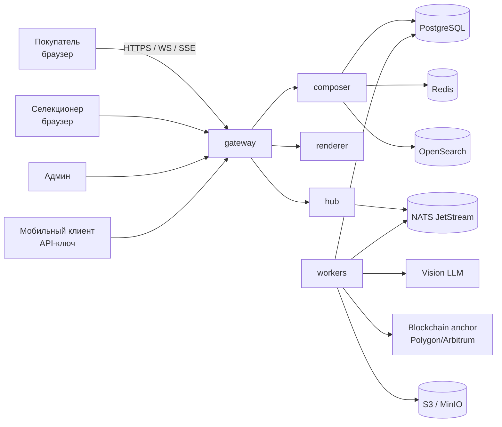
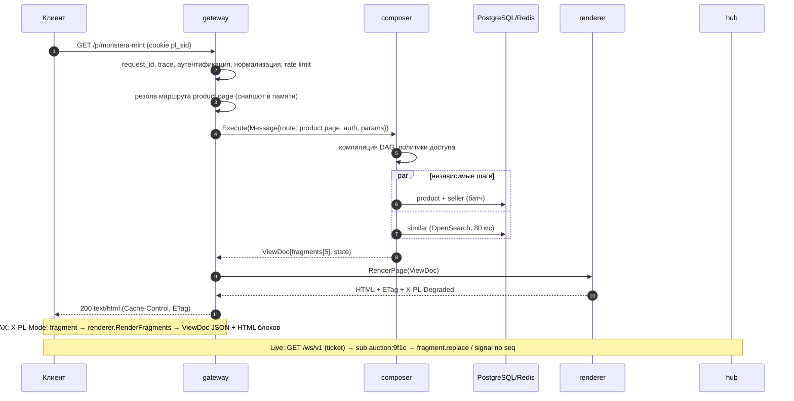

# 00. Обзор: требования, границы, ключевые решения

Документ описывает бэкенд **PhytoLedger** — маркетплейса редких растений с живыми аукционами,
чатом, мульти-магазинами, реестром селекции и escrow-кошельком. Стек: Go, PostgreSQL, Redis, NATS.
Цель набора — не рабочий код, а решения, которые определяют форму кода, и проверяемые последствия этих решений.

Навигация: [01 протокол](./01-protocol.md) · [02 маршруты данных](./02-data-routes.md) ·
[03 рендер](./03-render.md) · [04 клиент](./04-client.md) ·
[05 real-time](./05-realtime.md) · [06 эксплуатация](./06-operations.md) ·
[07 план внедрения](./07-roadmap.md) · [00 контракты](./00-contracts.md) ·
[08 ревью](./08-review.md)

---

## 1. Что мы строим (и чего не строим)

**Строим:** серверный слой, который (1) принимает запросы по HTTP/WS/SSE, (2) аутентифицирует и
превращает их в неизменяемое `Message`, (3) собирает данные по декларативному маршруту из БД с учётом
прав, (4) рендерит страницу целиком или набор блоков, (5) доставляет блоки клиенту по запросу и по
потоку событий.

**Не строим в этом документе:** мобильные приложения, дизайн-систему, блокчейн-ноды, инфраструктуру
стриминга видео (WebRTC/HLS — отдельный вендор), платёжный шлюз (внешний эквайринг + внутренний escrow).

**Явное ограничение:** фиатные деньги, escrow и блокчейн-анкоринг — зона, где «примерно работает»
недопустимо. Все денежные пути описаны как ACID-транзакция PostgreSQL + outbox, без кэша как источника истины.

---

## 2. Драйверы архитектуры

Требования превращаются в решения только через числа. Ниже — допущения, на которых держится весь
документ; если они неверны, пересматривать нужно §5 и главу 06.

| # | Сценарий | Допущение нагрузки | Архитектурное следствие |
|---|---|---|---|
| D1 | Лента товаров/аукционов, аноним | 40 RPS пик / 7 RPS средних (10k DAU), p95 < 300 мс | кэшируемый HTML, CDN, маршрут без персонализации |
| D2 | Карточка товара | 1 000 RPS, 8–15 блоков на страницу | 1 маршрут = 4–6 шагов, батчинг вместо N+1 |
| D3 | Комната аукциона | ~1 500 одновременных WS при 10k DAU; до 5 000 зрителей на топовый лот | WS/SSE fan-out, горячее состояние в Redis |
| D4 | Ставки | 3 ставки/с пик (10k DAU); 50 ставок/с — профиль 300k DAU, p95 < 150 мс | HTTP-команда + транзакция + outbox, не WS |
| D5 | Чат аукциона | 100 сообщений/с суммарно | партиционированная история, дедуп, модерация |
| D6 | Дашборд продавца (мульти-магазин) | 200 RPS, персонализированный | no-store, прямые запросы, без CDN |
| D7 | Реестр селекции + админка | 20 RPS, тяжёлые JOIN и модерация | отдельный маршрут, отдельный пул соединений |
| D8 | AI-описание сорта | 1 запрос = 5–20 с | асинхронная задача, не в цикле запроса |
| D9 | Доступность | 99.9% (~43 мин/мес) | деградация блоков вместо 5xx |

Целевой профиль первой версии: **10 000 DAU ≈ 7 RPS средних / 40 RPS пик, ~1 500 одновременных WS, 3 ставки/с**.
Профиль масштабирования (этап 5): **~300 000 DAU ≈ 350 RPS средних / 2 000 RPS пик, 10 000 WS, 50 ставок/с** —
именно он используется в нагрузочных тестах и смете [06-operations.md](./06-operations.md) §6.5/§6.9.
Держать оба профиля обязательно: мерить 2 000 RPS на стенде, рассчитанном на 40 RPS, — способ получить ложный отказ.

**Бюджеты задержек (сквозные, p95):**

```
HTTP-запрос:  gateway 15 мс  +  composer 120 мс  +  renderer 60 мс  +  сеть 50 мс  ≈ 245 мс
Ставка:       gateway 10 мс  +  валидация+БД 40 мс + outbox 10 мс + доставка 60 мс ≈ 120 мс
Событие чата: публикация 5 мс + fan-out 20 мс + доставка 60 мс                   ≈ 85 мс
```

---

## 3. Контекст (C4, уровень 1)



---

## 4. Контейнеры и поток одного запроса (C4, уровень 2)



**Кто что не делает:**

- `gateway` не знает домена (не лезет в БД за товаром), не рендерит HTML.
- `composer` не знает HTML и не форматирует цены — только данные и права.
- `renderer` не ходит в БД — получает `ViewDoc`, возвращает HTML.
- `hub` не читает БД на каждое событие — только маршрутизирует по топикам.
- `workers` не обслуживают пользовательские запросы — только фоновые процессы.

---

## 5. Разбор исходной схемы: что оставляем, что меняем

Исходная идея (три уровня: сервер → БД со «сборкой по маршруту» → сервис рендера) верна по духу.
Одно решение в ней несёт основной риск, два требуют уточнения. Ниже — построчно.

| Исходное предложение | Оценка | Решение в этом документе |
|---|---|---|
| Один HTTP/WS/SSE сервер: слушает, обрабатывает, структурирует в «Сообщение» | ✅ верно | `gateway` с единым конвертом `Message` (§4 контракта) + отдельный `hub` для соединений. WS/SSE имеют другой профиль нагрузки (память на соединение, а не CPU), поэтому логически разделены, физически могут жить в одном бинарнике |
| Аутентификация по ключам из заголовков | ⚠️ уточнить | Браузер: HttpOnly-сессия + CSRF + одноразовый ticket для WS. Заголовки-ключи — для мобильных/серверных клиентов, с HMAC-подписью и nonce. Долгоживущий «ключ в заголовке» в браузере — уязвимость, а не дизайн |
| Предобработка запроса, но редко | ✅ верно | Цепочка middleware в `gateway`: нормализация пути, allowlist query, locale/currency, UA-класс. Тяжёлая логика — не в middleware, а в шагах маршрута |
| **Запрос уходит в БД, и БД сама собирает данные по маршруту** | ⚠️ **ключевое изменение** | Маршрут **хранится** в БД как декларативный манифест (версионируется, редактируется без релиза), но **исполняется** Go-сервисом `composer`. Причины: безопасность (никакого динамического SQL из данных), тестируемость (golden-тесты на DataSet), наблюдаемость (span на шаг), отладка, кэш, доступ к не-SQL источникам (Redis, OpenSearch, блокчейн-анкор). См. ADR-001 и [02-data-routes.md](./02-data-routes.md) |
| Маршрут = таблица пути сбора данных с учётом прав | ✅ идея верна | Манифест: `steps` (DAG) + `fragments` + `variants` по `auth_level`. Права — трёхуровнево: policy (RBAC/ABAC) → row filter (RLS) → column projection (allowlist в реестре запросов) |
| БД возвращает JSON, где ключи — id HTML-блоков и шаблонов | ✅ верно | `ViewDoc` + `Fragment` с контрактом: версия блока, JSON Schema данных, ETag, TTL, статус (`ok/empty/degraded/error`). Ключ — `product.price`, а не CSS-id: блок должен быть адресуем и переиспользуем |
| Сервер → сервис рендера → сервер → клиент | ⚠️ уточнить | Интерфейс `Renderer` фиксируем сразу (это важно), но физически `renderer` стартует **в том же процессе**: два сетевых хопа на каждый запрос стоят ~2–5 мс и лишнюю точку отказа без выгоды. Выделение в отдельный сервис — когда нужен независимый масштаб или не-Go шаблоны (ADR-005) |
| Клиент разбирает ответ и обновляет нужные блоки | ✅ верно | Протокол событий с `seq`, ETag, `fragment.replace/state.patch/signal`, morph без потери фокуса, resume по `Last-Event-ID`, прогрессивное улучшение без JS |
| — | ❌ отсутствовало | Идемпотентность команд, слои кэша и инвалидация по тегам, деградация фрагментов, backpressure в стримах, наблюдаемость/SLO, outbox для денег, санитайз UGC, версионирование контрактов, нагрузочные критерии |

**Вывод:** исходная схема сохраняется как каркас; меняются два несущих узла — «БД как оркестратор»
(становится «данные как манифест + исполнитель в коде») и «рендер всегда отдельным сервисом»
(становится «порт сейчас, сервис позже»).

---

## 6. Реестр решений (ADR-индекс)

| ID | Решение | Отвергнуто | Глава |
|---|---|---|---|
| ADR-001 | Маршруты — декларативные манифесты в БД, исполняет Go-composer | PL/pgSQL-оркестрация, захардкоженный BFF, GraphQL | 02 |
| ADR-002 | Единый `Message`/`ViewDoc` конверт для HTTP/WS/SSE | три независимых API | 01 |
| ADR-003 | Браузер: HttpOnly-сессия + CSRF + ticket для WS; API-ключи с HMAC для не-браузерных клиентов | Bearer в localStorage, токен в query string | 01 |
| ADR-004 | Данные возвращаются по блокам с ETag/seq/статусом, а не «страница целиком» | полная перезагрузка, голый JSON без контракта | 00/03 |
| ADR-005 | `renderer` — интерфейс сразу, отдельный сервис позже | «монолит навсегда», «микросервисы сразу» | 03 |
| ADR-006 | Деньги только через HTTP-команду с `Idempotency-Key` + PG-транзакция + outbox | ставки по WS, Redis как источник истины | 05 |
| ADR-007 | Единая модель топиков/seq для WS и SSE, fan-out через NATS | Redis pub/sub как основной транспорт | 05 |
| ADR-008 | Кэш трёхуровневый (CDN → HTML фрагмента → данные шага) с инвалидацией по тегам | «кэшируем всё» / «не кэшируем ничего» | 02/06 |
| ADR-009 | Права трёхуровнево: policy → RLS row filter → column projection | «проверка в хендлере» | 02 |
| ADR-010 | Клиентский runtime — свой ~10 KB, без фреймворка, с работой без JS | SPA на React, htmx как единственный транспорт | 04 |

**Нумерация.** `ADR-0NN` — глобальные решения из таблицы выше; на них ссылаются все главы.
`ADR-<глава>.<n>` (например `ADR-01.3`) и `ADR-03-02` — локальные решения внутри главы: они детализируют
глобальное, но не отменяют его. При расхождении приоритет у глобального. Главы 05 и 06 используют
сокращение `ADR` без номера для решений внутри своего раздела.

---

## 7. Как читать набор

| Если вы… | Читайте |
|---|---|
| продукт/руководитель | этот файл, §5, [07-roadmap.md](./07-roadmap.md) |
| backend-разработчик | 00 → 01 → 02 → 03 |
| frontend-разработчик | 00 → 04 → 03 (§7–8) |
| SRE/DevOps | 00 → 05 → 06 |
| ревьюер архитектуры | весь набор + 08-review |

Порядок внедрения — [07-roadmap.md](./07-roadmap.md): сначала контракт и один сквозной маршрут,
потом блоки и поток, потом деньги и масштаб. Не наоборот.

---

## 8. Бизнес-сущности (краткий глоссарий для глав)

| Сущность | Смысл | Ключевое ограничение |
|---|---|---|
| `User` | аккаунт, владелец магазинов, участник аукционов | баланс только через транзакции + аудит |
| `Shop` | тематическая витрина внутри аккаунта (1:N) | кастомизация только через design tokens |
| `Product` (лот) | экземпляр растения на продажу | привязка к `Variety`, статус `available/reserved/sold` |
| `Auction` | торги с таймером и стримом | антиснайпинг, резерв средств на ставку |
| `Bid` | ставка | append-only, идемпотентна, хэш в сайдчейн (позже) |
| `Variety` | зарегистрированный сорт в реестре | верификация админом/сообществом, генетическое трио фото |
| `Order` | заказ (прямой или выигранный лот) | статусная модель, escrow-холд |
| `WalletTx` | движение по внутреннему кошельку | append-only, идемпотентно, только через outbox |
| `ChatRoom` | чат сделки или аукциона | привязка к контексту (лот/аукцион) |
| `Fragment` | блок интерфейса | контракт данных + версия + ETag |

---

## 9. Ограничения и допущения документа

1. Один регион, одна основная БД (read-replicas допустимы), без шардирования на старте.
2. Валюта — RUB; мультивалютность (крипто-цены) — расширение `Hints.Currency`, а не второй стек.
3. Видеострим аукциона приходит с внешнего провайдера; наш бэкенд только хранит `stream_url` и статус.
4. Блокчейн — вторичный реестр: истина в PostgreSQL, анкоринг асинхронен и допускает задержку.
5. Все числа §2 — стартовые гипотезы для нагрузочных тестов, а не обещания.
