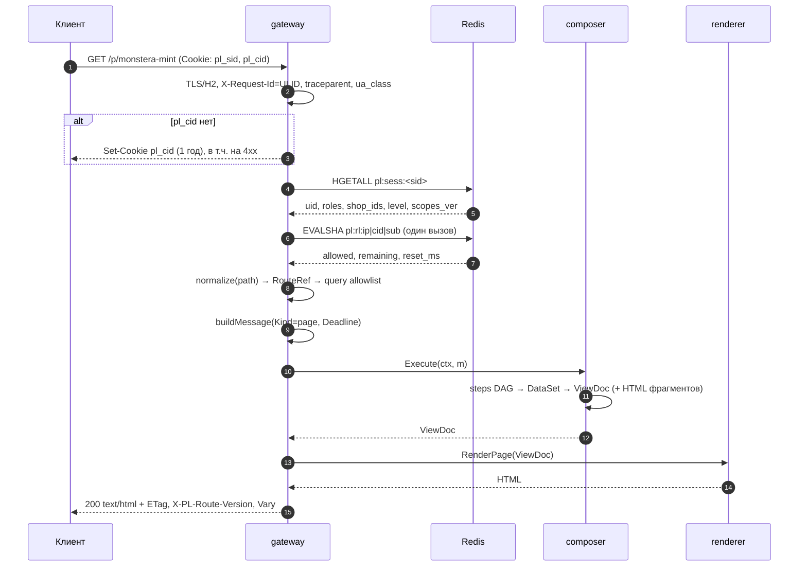
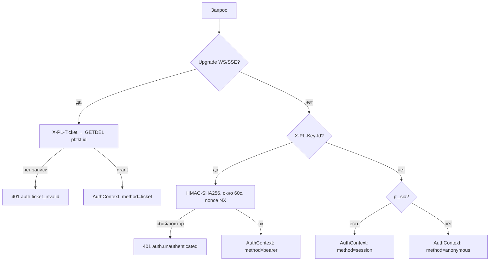

# 01. Протокол: транспорты, аутентификация, `Message`

> Как HTTP/WS/SSE превращаются в один `message.Message` (§4), как `gateway` аутентифицирует,
> нормализует, ограничивает и маршрутизирует запрос и какие бюджеты задержек соблюдает.
> Типы, заголовки, коды и префиксы — из §4–§10 `00-contracts.md`; здесь они только применяются.

---

## 1. Один конверт на три транспорта

`Message` — единственный вход `composer`; транспорт — адаптер, а не отдельный API.

| Транспорт | `Kind` | Источник полей |
|---|---|---|
| `GET` страницы | `page` | `Path`/`Params` из маршрута, `Query` — из allowlist манифеста |
| `GET` + `X-PL-Mode: fragment` | `fragment` | `Hints.Fragments` ← `X-PL-Fragments` (≤ 12 id) |
| `POST/PATCH/DELETE /v1/*` | `command` | `Body` (≤ 1 MiB), `Meta.IdempotencyKey` |
| WS-кадр после upgrade | `stream.subscribe` | `Route`+`Params` из URL сокета, `Hints.LastSeq=0` |
| SSE-запрос | `sse.subscribe` | `Hints.LastSeq` ← `Last-Event-ID` |

Топик клиент **не передаёт**: он выводится из манифеста потокового маршрута (`stream.topic: "auction:{id}"`),
а hub повторно проверяет ACL (§9). Иначе клиент подписался бы на `user:<чужой_id>`.

**ADR-01.1. Единый `Message` вместо трёх независимых API.**
**Решение:** все транспорты собирают один тип; auth, rate limit, идемпотентность, дедлайн и логи — один раз в `gateway`.
**Почему:** WS-подписке и HTTP-запросу нужны одни права и трейс; три протокола — три поведения и три места для дыр. `Deadline`/`SchemaVersion` задаются в одной точке, golden-фикстуры `Message` переиспользуются тестами composer.
**Отвергнуто:** REST+WS как два контракта (дрейф прав); передача `*http.Request` в `composer` (транспорт протекает в домен, догон SSE невозможен); GraphQL/BFF (клиент считает бизнес-значения — §3.8).
**Последствия:** `Message` — горячий тип, поля только аддитивно (§12); особенности транспорта живут в `Hints`. Инвариант §3.1 буквально: сборка по значению, шагам — копия.

---

## 2. Жизненный цикл запроса в gateway



| # | Шаг | Что происходит и где ломается |
|---|---|---|
| 1 | TLS/HTTP | H2 включён; лимиты и `ReadHeaderTimeout` — §8. Входящий `X-Request-Id` принимается только с подписи edge, иначе ULID; он же родитель спана |
| 2 | `pl_cid` | Нет cookie → новый ULID, ставится всегда (включая 401/404): без него у анонимной ленты нет ключа лимита |
| 3 | Аутентификация | `AuthContext`; scopes вычисляются здесь и далее неизменяемы (§3) |
| 4 | Нормализация | Канонизация пути (trailing slash, однократное %-декодирование, lowercase slug); `locale`/`currency` — cookie → `Accept-Language` → дефолт (§4) |
| 5 | Rate limit | pre-auth по ip, затем subject/cid — одним Lua-вызовом (§7) |
| 6 | Резолв маршрута | `(method, path, auth_level)` → `RouteRef` + allowlist query; неизвестные параметры отбрасываются, не 400 (§4) |
| 7 | Сборка `Message` | один раз, по значению; `Deadline = min(ReceivedAt+budget_ms, hard cap)` |
| 8 | `composer.Execute` | `ctx` рвётся по `Deadline`; остаток < 30 мс → деградация без новых внешних вызовов |
| 9 | `renderer.RenderPage` / `RenderFragments` | HTML собирает только `renderer`, вызывает его `gateway`; `composer` отдаёт `ViewDoc` без HTML (§7 контракта). `fragment` → `RenderFragments` по запрошенным id |
| 10 | Ответ | `ETag` (страница — из ETag фрагментов, §10), `X-PL-Route`, `X-PL-Route-Version`, `X-PL-Degraded`, `Cache-Control` (§3.7), `Vary` |
| 11 | Лог/метрика | одна строка (route, status, duration, cache, degraded, subject) + `pl_http_request_duration_seconds{route,status}`; не логируются `Cookie`, `X-PL-Signature`, `X-PL-Ticket`, body команд |

**ADR-01.2. Резолв маршрута до применения query-allowlist.**
**Решение:** два прохода: путь канонизируется до резолва (по нему ищем маршрут), query фильтруется после — по `match.query` найденного манифеста.
**Почему:** allowlist — свойство маршрута, а ищется маршрут по пути; валидировать неизвестный query «наугад» значит отклонять легитимные параметры.
**Отвергнуто:** глобальный allowlist (ломает новые маршруты без деплоя gateway); 400 на неизвестный параметр (ломает UTM-метки).
**Последствия:** в `Message.Query` только объявленные параметры уже приведённых типов.

---

## 3. Аутентификация

Один креденшел на запрос: `ticket` (только upgrade) → `X-PL-Key-Id` → `pl_sid` → anonymous. Смешивание (`Cookie` + подпись) отклоняется 401: неоднозначный субъект = неоднозначные права. Механика: ticket — `GETDEL pl:tkt:<id>` до upgrade; ключ — HMAC, затем nonce; cookie — `HGETALL pl:sess:<sid>`.



### 3.1. Браузер: `pl_sid` + `pl_rt`

`pl_sid` — непрозрачный id сессии, `HttpOnly; Secure; SameSite=Lax; Path=/; Max-Age=2592000` (§10). Полезной нагрузки в cookie нет: роли и scopes в Redis, поэтому отзыв прав действует на следующем запросе. Refresh `pl_rt` (`Path=/auth`, 90 дней) = `<sid>.<secret_256>`; в сессии — `sha256(secret)` и поколение. `POST /auth/refresh` ротирует пару: `rt_gen++`, старый хеш живёт 60 с (гонка вкладок). Предъявление хеша старше 60 с = **reuse-detection**: инвалидируются все сессии субъекта (`pl:sess:uid:<uid>`), аудит-событие, клиент идёт на вход. CSRF — double-submit `pl_csrf` + `X-CSRF-Token` плюс `Origin`/`Sec-Fetch-Site`; только для cookie-метода и только для `command`.

**ADR-01.3. Cookie-сессия для браузера, не Bearer в localStorage.**
**Решение:** opaque `pl_sid` в HttpOnly cookie; привилегированные действия — команды с CSRF.
**Почему:** localStorage читается любым XSS и сторонним скриптом; токен в JS не отозвать до истечения; нет `SameSite`, списка сессий и «выйти везде». Продукт SSR-first (SEO, §1) — cookie едет навигацией.
**Отвергнуто:** JWT в localStorage (отзыв = чёрный список, т.е. снова Redis); access-JWT в памяти + refresh (сложность без выигрыша в одном регионе); сессия в подписанной cookie (нет отзыва, пухнут заголовки).
**Последствия:** каждый аутентифицированный запрос — 1 Redis RTT (§10); HA Redis обязателен; мобильные и серверные клиенты идут путём §3.2.

### 3.2. API-ключи для мобильных и серверов

`kid` публичен (`plk_live_<ulid>`), секрет показывается один раз и хранится AES-GCM-шифртекстом под KEK; кэш `pl:key:<kid>` — 60 с, сброс по `ev.cache.purge`. Подпись `HMAC-SHA256(secret, method\npath\nsha256(body)\nts\nnonce)`; заголовки `X-PL-Key-Id`, `X-PL-Signature`, `X-PL-Timestamp`, `X-PL-Nonce`. Окно ±60 с, nonce — `SET pl:nonce:<kid>:<nonce> NX EX 120` (аддитивный префикс к §10), сравнение `hmac.Equal`. Ротация: 24 ч два активных kid, затем старый `revoked`; кэш чистится событием, отзыв мгновенный.

### 3.3. Ticket для WS/SSE

`POST /v1/stream/tickets` (cookie или ключ) → `{ticket, expires_in: 30}`. В Redis `pl:tkt:<id>` = `{uid, scopes, topics_allow, transport, cid}`, TTL 30 с, погашение атомарным `GETDEL` (single-use). Браузерный `new WebSocket()` не умеет ставить заголовки, поэтому ticket идёт сабпротоколом `Sec-WebSocket-Protocol: pl.v1, pl.ticket.<t>` (эхо — только `pl.v1`); fetch-based SSE — заголовком `X-PL-Ticket`. `EventSource`-фолбэк допустим только с ticket в query, с редакцией параметра в логах и `Cache-Control: no-store`.

**ADR-01.4. Ticket вместо токена в URL сокета.**
**Решение:** одноразовый 30-секундный ticket, привязанный к subject, транспорту и списку топиков.
**Почему:** query попадает в access-логи, `Referer`, историю прокси и APM, а токен там живёт минуты и переиспользуем; ticket — 30 с, атомарное погашение, одно соединение, ограниченные топики.
**Отвергнуто:** долгоживущий токен в query (утечка); cookie-аутентификация сокета (мешает cross-origin мобильным клиентам, нет отдельного TTL).
**Последствия:** лишний HTTP-раунд перед соединением; при обрыве клиент берёт новый ticket (закрытие `4401` = «иди за ticket»); несколько вкладок = несколько ticket'ов.

### 3.4. Сессии в Redis

```
pl:sess:<sid>      HASH, TTL 30d скользящий, но не более 30d от created_at
  uid, level, roles[], shop_ids[], verified, created_at, last_seen, ip24
  scopes_ver       # инкремент при смене ролей → принудительный пересчёт scopes
  rt_hash, rt_prev_hash, rt_prev_until, rt_gen
  fp_hash          # sha256(ua_class|accept-language|tz) — мягкая привязка
pl:sess:uid:<uid>  ZSET score=last_seen member=sid  # logout-everywhere, лимит 10 сессий
```

`fp_hash` не рвёт сессию, а помечает её `soft_mismatch` и требует повторного входа только для денежных команд: смена часового пояса — норма, `wallet.withdraw` из нового отпечатка — нет. 11-я сессия вытесняет самую старую + `ev.user.<id>.session_evicted`.

### 3.5. Права

`scopes` вычисляются один раз при аутентификации: `user → roles → scopes` по таблице роль→scope в коде (`catalog.read`, `auction.bid`, `wallet.read`, …). `AuthContext` далее неизменяем: `composer` проверяет `policy` шага против `Scopes`, hub — ACL топика против тех же scopes. Ни шаг, ни фрагмент прав не расширяют: `policy` без scope → фрагмент `degraded`, обязательный шаг → 403 на маршрут.

---

## 4. Резолв маршрута

Таблица маршрутов — **неизменяемый снапшот** за `atomic.Value`; запрос не ходит в БД. Собирается из `status: published` при старте и пересобирается по `ev.cache.purge` (`kind=routes`), который публикует `workers` после публикации/отзыва версии; страховка — TTL 30 с и сверка `checksum`.

- Дерево сегментов: статический > параметрический `{slug}` > хвостовой `{*rest}`; при равенстве — более специфичный шаблон; конфликт шаблонов ловит валидатор публикации (§6.2).
- `405 vs 404`: путь совпал с шаблоном, метод запрещён → `405`+`Allow`; ни один шаблон не совпал → `404`. Страница 404 — такой же маршрут (`system.404`) через тот же конвейер.
- `draft`/`retired` в снапшот не попадают; `draft` — только по `?__preview=<ver>` при scope `admin.routes` и с `Cache-Control: private, no-store`.
- `RouteRef.Version` фиксируется в `Message`; `composer` обязан исполнить **именно** эту версию (`pl:cache:route:<id>:<ver>`), даже имея новую, иначе `X-PL-Route-Version`, состав фрагментов и ETag разъедутся.
- Отказ Redis/БД: снапшот из локального файла последнего деплоя, иначе `503` — но не пустая таблица, иначе весь сайт превращается в 404.

**ADR-01.5. Снапшот маршрутов в памяти + версия в `RouteRef`.**
**Решение:** резолв по in-memory дереву, O(глубина); применённая версия едет в `Message`.
**Почему:** чтение JSONB-манифеста на каждый запрос — +1–3 мс p99 и единая точка отказа для всего трафика; манифесты меняются редко и атомарно.
**Отвергнуто:** кэш манифеста в Redis на каждый запрос (лишний RTT); резолв в БД (несовместим с §10).
**Последствия:** окно расхождения ≤ 30 с; нужен канареечный эндпоинт сверки версий между инстансами; откат версии — новая публикация.

---

## 5. AJAX против навигации

Правило: **один URL — два представления — один `ViewDoc`**. Отдельных «AJAX-ручек» нет: ветвление только в `gateway` и `renderer`.

| Аспект | Навигация | AJAX-фрагмент |
|---|---|---|
| Запрос | `Accept: text/html` | `X-PL-Mode: fragment`, `Accept: application/vnd.pl.viewdoc+json` |
| `Kind` | `page` | `fragment` |
| Тело | HTML-документ `pages/*` | `ViewDoc`, `Page=nil`, только `Hints.Fragments` |
| Кэш | `public, s-maxage=30, stale-while-revalidate=120` (аноним) | `private, no-store` (кэш — в composer/renderer) |
| `ETag`/`304` | страничный из ETag фрагментов (§10), `If-None-Match` | составной ETag выбранных id |

`Vary: Accept, Accept-Language, X-PL-Mode`. `Accept-Language` обязателен (локаль меняет HTML), `X-PL-Mode` — иначе CDN отдаст HTML на fragment-запрос. `Vary: Cookie` запрещён: он убивает кэш; приватный слой включается по факту `AuthContext`, а не по наличию cookie.

Прогрессивное улучшение: `<a href="/p/slug">` и `<form method="post" action="/v1/auctions/{id}/bids">` работают без JS. Команда с `Accept: text/html` отвечает `303` на целевой URL (флеш — в короткоживущей cookie), с `X-PL-Mode: fragment` — `200` + `ViewDoc` с обновлёнными фрагментами и `ack`. JS не собирает HTML и не считает цены (§3.8) — только морфит блоки по id.

---

## 6. Команды и идемпотентность

Деньги — только HTTP-команда + `Idempotency-Key` + PG-транзакция с outbox (§3.5).

```sql
CREATE TABLE idempotency_keys (
  subject_id       uuid        NOT NULL,
  key              text        NOT NULL,          -- ULID/UUID клиента, 16..128
  endpoint         text        NOT NULL,          -- "POST /v1/auctions/{id}/bids"
  fingerprint      bytea       NOT NULL,          -- sha256(method|path|body|route_version)
  status           text        NOT NULL CHECK (status IN ('in_progress','completed','failed')),
  response_code    int,
  response_body    jsonb,                         -- ViewDoc, не HTML
  response_headers jsonb,
  route_version    int         NOT NULL,
  created_at       timestamptz NOT NULL DEFAULT now(),
  expires_at       timestamptz NOT NULL,
  CONSTRAINT idempotency_keys_pk PRIMARY KEY (subject_id, key)
);
CREATE INDEX idempotency_keys_gc_idx    ON idempotency_keys (expires_at) WHERE status <> 'in_progress';
CREATE INDEX idempotency_keys_stale_idx ON idempotency_keys (created_at) WHERE status = 'in_progress';
-- stale: уборка брошенных попыток (>2 мин) через pg_cron
```

Поток: `INSERT … ON CONFLICT (subject_id, key) DO NOTHING RETURNING 1`. Вставили — исполняем команду в той же транзакции, пишем ответ и outbox, `status='completed'`. Не вставили: `fingerprint` не совпал → `422 idempotency.key_reused` (аддитивный код к §8: тот же ключ с другим телом — ошибка клиента, не replay); `completed` → сохранённые код/тело, `Idempotent-Replay: true`, 200 (`idempotency.replay`, §8), HTML перерендеривается из `response_body`; `in_progress` → ждём до 300 мс (шаг 50 мс), затем `409 idempotency.replay` + `Retry-After: 1`. Команда над версией агрегата требует `If-Match` → иначе `conflict.version`. TTL — из манифеста (`idempotency: {ttl: 24h}`, для ставки 1 ч), чистится джобой.

**Нельзя делать идемпотентным:** чтения (ключ на GET маскирует ошибки клиента); выпуск ticket/nonce (каждый выпуск — новое соединение); `logout`/`logout-everywhere` (повтор должен работать, а не возвращать кэш); запрос AI-описания по кнопке (каждый вызов — биллинг-юнит); повторная заявка/апелляция (разные легитимные намерения).

---

## 7. Rate limiting

Один EVALSHA на запрос: все уровни в одном Lua-вызове, иначе 3–4 RTT в горячем пути.

```lua
-- KEYS: pl:rl:<scope>:<key> для ip / cid / subject / kid;  ARGV: now_ms, rate, burst, cost
-- → {ok, remaining, reset_ms}
local now, rate, burst, cost = tonumber(ARGV[1]), tonumber(ARGV[2]), tonumber(ARGV[3]), tonumber(ARGV[4])
local ok, left, reset = 1, 1000000, 0
for i = 1, #KEYS do
  local s = redis.call('HMGET', KEYS[i], 'tokens', 'ts')
  local tokens = (tonumber(s[1]) or burst) + math.max(0, now - (tonumber(s[2]) or now)) / 1000 * rate
  tokens = math.min(burst, tokens) - cost
  if tokens < 0 then
    ok, reset, tokens = 0, math.max(reset, math.ceil(-tokens / rate * 1000)), 0
  else
    left = math.min(left, math.floor(tokens))
  end
  redis.call('HSET', KEYS[i], 'tokens', tokens, 'ts', now)
  redis.call('PEXPIRE', KEYS[i], 60000)
end
return {ok, left, reset}
```

| Класс маршрута | Лимит | Ключ |
|---|---|---|
| HTML лента/каталог (аноним) | 120/мин, burst 60 | ip + cid |
| Страница товара/аукциона | 240/мин, burst 120 | cid |
| Фрагменты (AJAX) | 600/мин, burst 120 | cid + subject |
| `/v1` команды (кроме денег) | 60/мин, burst 20 | subject |
| Ставка `auction.bid` | 6/мин на аукцион + 30/мин всего | subject |
| `/auth/*` (login, refresh) | 10/мин на ip + 5/час на email | ip |
| Выпуск ticket | 10/мин | subject |

Заголовки: `X-RateLimit-Limit`, `X-RateLimit-Remaining`, `X-RateLimit-Reset` (unix); отказ — `429 rate.limited` + `Retry-After`. Ключи субъектов хэшируются (не PII в именах ключей).

**ADR-01.6. Fail-open для чтения, fail-closed для денег.**
**Решение:** Redis недоступен → чтения пропускаются с локальным per-instance GCRA и метрикой; классы `bid`/`command`/`auth` → `503` + `Retry-After: 2`.
**Почему:** отказ Redis не должен превращать каталог в 503 (трафик и SEO), но неограниченные ставки без лимита — прямой способ сломать аукцион и получить двойное списание.
**Отвергнуто:** fail-open везде (открывает денежные endpoint'ы); fail-closed везде (Redis-блип = сайт лежит); лимиты только на edge (не знают subject и scope).
**Последствия:** два режима деградации, нужен `X-PL-Degraded: ratelimit` и алерт; в fail-open `X-RateLimit-*` считаются по локальному GCRA.

---

## 8. Лимиты и защита

| Параметр | Значение | Почему |
|---|---|---|
| Body | 1 MiB (`/v1`), 64 KiB (страницы) | медиа — через presigned S3, не через gateway |
| Заголовки | 16 KiB суммарно, ≤ 100 | защита от header-bloat |
| URL | 8 KiB | длинные slug/фильтры не нужны |
| `ReadHeaderTimeout`/`ReadTimeout` | 2 с / 5 с | slowloris |
| `WriteTimeout` | 15 с; WS/SSE — hijack, idle 60 с, `ping` 15 с | §9 |
| `MaxConcurrentStreams` (H2) | 100 | H2 обесценивает per-connection лимит → лимит per-request |

CORS — только `/v1/*`: allowlist origin, без wildcard при credentials, `Max-Age: 600`, `Expose-Headers: X-Request-Id, X-PL-Route, X-PL-Route-Version, X-PL-Degraded, X-RateLimit-*`. На каждом HTML: `HSTS`, `X-Content-Type-Options: nosniff`, `Referrer-Policy: strict-origin-when-cross-origin`, `Cross-Origin-Opener-Policy: same-origin`, CSP с nonce и `require-trusted-types-for 'script'; trusted-types pl;` — DOM-патчи из WS идут только через политику `pl`, никакого `innerHTML` из `Event.HTML` без санитайзера. Требование к renderer: без inline-обработчиков и `javascript:` URL. Отклоняются: `Content-Length` вместе с `Transfer-Encoding: chunked` (smuggling), `\r\n`/NUL в заголовках, дубли `Cookie`/`Idempotency-Key`.

---

## 9. Go: иллюстративные фрагменты

```go
// internal/gateway/router.go
func NewRouter(g *Gateway) http.Handler {
	r := chi.NewRouter()
	r.Use(middleware.Recoverer, g.requestID, g.trace, g.clientID, g.headerLimits)
	r.Route("/v1", func(api chi.Router) {
		api.Use(g.limitPreAuth, g.authRequired, g.csrfDoubleSubmit, g.idempotency, g.limitSubject)
		api.Post("/auctions/{id}/bids", g.command("auction.bid"))
		api.Post("/cart/items", g.command("cart.add"))
		api.Post("/registry/applications", g.command("registry.apply"))
	})
	r.Group(func(pub chi.Router) {
		pub.Use(g.limitPreAuth, g.authOptional, g.normalize, g.resolveRoute, g.limitSubject)
		pub.Get("/ws/v1/{family}/{id}", g.wsUpgrade)
		pub.Get("/sse/v1/{family}/{id}", g.sse)
		pub.Get("/*", g.page) // любая страница — только через манифест
	})
	return r
}
```

```go
// internal/gateway/message.go — сборка один раз, по значению
func (g *Gateway) buildMessage(r *http.Request, a auth.Result, rt route.Match, now time.Time) message.Message {
	m := message.Message{
		Meta: message.Meta{
			SchemaVersion:  "1",
			RequestID:      reqIDFrom(r.Context()),
			TraceID:        traceIDFrom(r.Context()),
			ClientID:       clientIDFrom(r.Context()),
			SessionID:      a.SessionID,
			IdempotencyKey: r.Header.Get("Idempotency-Key"),
			Transport:      message.TransportHTTP,
			ReceivedAt:     now,
			Deadline:       minTime(now.Add(rt.Budget), hardCap(rt.Kind)),
			UAClass:        ua.Class(r.UserAgent()),
		},
		Auth:   a.Context, // scopes вычислены при аутентификации и неизменяемы
		Kind:   kindFor(r, rt),
		Route:  message.RouteRef{ID: rt.ID, Version: rt.Version, Pattern: rt.Pattern},
		Path:   rt.CanonicalPath,
		Params: rt.Params,
		Query:  rt.Query,
		Hints:  hintsFrom(r, rt),
	}
	if m.Kind == message.KindCommand {
		m.Body = bodyFrom(r.Context()) // уже прочитан под лимитом 1 MiB
	}
	return m
}
```

```go
// internal/gateway/auth.go — ровно один метод на запрос
func (a *Auth) resolve(r *http.Request) (message.AuthContext, error) {
	anon := message.AuthContext{Method: message.AuthAnonymous, Subject: message.Subject{Level: "anonymous"}}
	if kid := r.Header.Get("X-PL-Key-Id"); kid != "" {
		key, err := a.keys.Get(r.Context(), kid) // pl:key:<kid>, TTL 60s
		if err != nil {
			return anon, ErrUnauthenticated
		}
		sum := sha256.Sum256(bodyFrom(r.Context()))
		canon := r.Method + "\n" + r.URL.EscapedPath() + "\n" + hex.EncodeToString(sum[:]) +
			"\n" + r.Header.Get("X-PL-Timestamp") + "\n" + r.Header.Get("X-PL-Nonce")
		mac := hmac.New(sha256.New, key.Secret)
		mac.Write([]byte(canon))
		if !hmac.Equal(mac.Sum(nil), sigFrom(r)) {
			return anon, ErrSignature
		}
		if !a.nonceOnce(r.Context(), kid, r.Header.Get("X-PL-Nonce"), 120*time.Second) {
			return anon, ErrReplay // pl:nonce:<kid>:<nonce>, окно 60 с
		}
		return a.context(key.Subject, message.AuthSigned), nil
	}
	sid, err := r.Cookie("pl_sid")
	if err != nil {
		return anon, nil
	}
	sess, err := a.sessions.Get(r.Context(), sid.Value) // HGETALL pl:sess:<sid>
	if err != nil || sess.Expired() {
		return anon, ErrUnauthenticated
	}
	return a.context(sess.Subject, message.AuthSession), nil
}
```

```go
// internal/gateway/stream.go — upgrade по ticket, а не по токену в URL
func (g *Gateway) wsUpgrade(w http.ResponseWriter, r *http.Request) {
	tk := ticketFromHandshake(r) // X-PL-Ticket или субпротокол pl.ticket.<t>
	if tk == "" {
		writeProblem(w, r, problem.Of(codes.TicketInvalid, "ticket отсутствует"))
		return
	}
	grant, err := g.Tickets.Redeem(r.Context(), tk) // GETDEL pl:tkt:<id>, single-use
	if err != nil {
		writeProblem(w, r, problem.Of(codes.TicketInvalid, "ticket просрочен или использован"))
		return
	}
	if !grant.Allows(r.PathValue("family"), r.PathValue("id")) { // топик — из манифеста
		writeProblem(w, r, problem.Of(codes.Forbidden, "нет доступа к топику"))
		return
	}
	conn, err := g.upgrader.Upgrade(w, r, http.Header{"Sec-WebSocket-Protocol": {"pl.v1"}})
	if err != nil {
		return // Upgrader уже ответил 400
	}
	g.Hub.Attach(r.Context(), hub.Conn{WS: conn, Subject: grant.Subject,
		Scopes: grant.Scopes, Topics: grant.Topics, CID: grant.CID})
}

func writeProblem(w http.ResponseWriter, r *http.Request, p *problem.Problem) {
	p.RequestID, p.TraceID = reqIDFrom(r.Context()), traceIDFrom(r.Context())
	w.Header().Set("Content-Type", "application/problem+json; charset=utf-8")
	w.Header().Set("Cache-Control", "no-store")
	w.WriteHeader(p.Status)
	_ = json.NewEncoder(w).Encode(p) // RFC 9457, §8
}
```

```json
{"type":"https://phyto.dev/errors/rate-limited","title":"Too Many Requests","status":429,
 "code":"rate.limited","detail":"Слишком много ставок, подождите","retry_after":1,
 "request_id":"01JBQ7…","trace_id":"4bf9…"}
```

---

## 10. Бюджеты задержек

Бюджет маршрута (`budget_ms`) режет `Meta.Deadline`; жёсткие потолки gateway: 800 мс страница, 250 мс фрагменты, 150 мс команда, 40 мс ticket.

| # | Этап | p50, мс | p99, мс | Лимит |
|---|---|---|---|---|
| 1 | accept, ULID, `pl_cid`, ua_class | 0.05 | 0.2 | — |
| 2 | auth (Redis HGETALL) | 0.35 | 1.8 | 5 мс |
| 3 | нормализация пути/query | 0.03 | 0.1 | 1 мс |
| 4 | rate limit (один EVALSHA) | 0.40 | 2.5 | 5 мс |
| 5 | резолв маршрута (память) | 0.01 | 0.05 | 1 мс |
| 6 | сборка/валидация `Message` | 0.05 | 0.2 | 1 мс |
| 7 | **итого до `composer`** | **≈0.9** | **≈4.9** | **10 мс** |
| 8 | `composer.Execute` (страница) | 120 | 380 | `budget_ms` = 400 |
| 9 | `renderer.RenderPage` | 12 | 35 | 60 мс |
| 10 | запись ответа + заголовки | 0.5 | 3 | — |
| 11 | **итого после `composer`** | **≈13** | **≈40** | **80 мс** |
| — | страница целиком | 135 | 430 | 500 мс |
| — | фрагмент (AJAX) | 60 | 180 | 250 мс |
| — | команда `auction.bid` | 25 | 90 | 150 мс |

Остаток `Deadline` < 30 мс → новые внешние вызовы запрещены, фрагменты сразу `degraded`; `ctx` отменяется по `Deadline` и по обрыву клиента (иначе `composer` греет полные DAG'и в пустоту); otel-спан `gateway.execute` — дочерний к серверному, чтобы p99 раскладывался по этапам.

---

## Риски и что сломается первым

1. **Redis общий для сессий, лимитов, nonce и ticket.** Первым ломается rate limiting: горячий ключ популярного аукциона даёт десятки тысяч RPS в один `pl:rl:*`. Лечение — шардирование по subject, локальный GCRA-бэкстоп, отдельный Redis под сессии.
2. **Окно подписи ±60 с.** Часы мобильных клиентов уплывают → массовые 401 в приложении. Нужен `Date` в ответе 401 и подсказка «проверьте время», иначе поддержка захлебнётся.
3. **Single-use ticket против реконнектов.** Каждый обрыв сети требует HTTP-раунда; шторм реконнектов во время эфира = ×N нагрузки на `/v1/stream/tickets`. Нужен backoff и лимит одновременных топиков на subject.
4. **Расхождение снапшотов маршрутов** при потерянном `ev.cache.purge`: gateway отдаёт v12, composer исполняет v13 → нестабильные ETag, лишние полные перерисовки, «мигающий» блок цены.
5. **`Fragment.HTML` внутри `ViewDoc`** раздувает AJAX-JSON (12 фрагментов — сотни КБ) и кэш в Redis; на 3G заметно. Ограничение `X-PL-Fragments` и сжатие нужны с первого дня.
6. **CSP и Trusted Types** ломают стороннюю аналитику и платёжные виджеты: только nonce + санитайзер, иначе маркетинг «поставит скрипт» и снимет заголовок.

## Открытые вопросы

1. `pl_cid` на 1 год — достаточная псевдонимизация по 152-ФЗ или нужен consent-барьер и хранение 30 дней для анонимов?
2. Внутри кластера остаётся HMAC (`signed`) или переходим на mTLS/SPIFFE — от этого зависит, нужен ли `pl:nonce` в проде вообще.
3. Хранить в `idempotency_keys.response_body` только `ViewDoc` (перерендер после деплоя renderer может дать другой HTML) или фиксировать и HTML — ценой размера таблицы и риска отдать устаревшую разметку?
4. Нужен ли `EventSource`-фолбэк с ticket в query для старых Safari, или fetch-стрим покрывает целевые браузеры?
