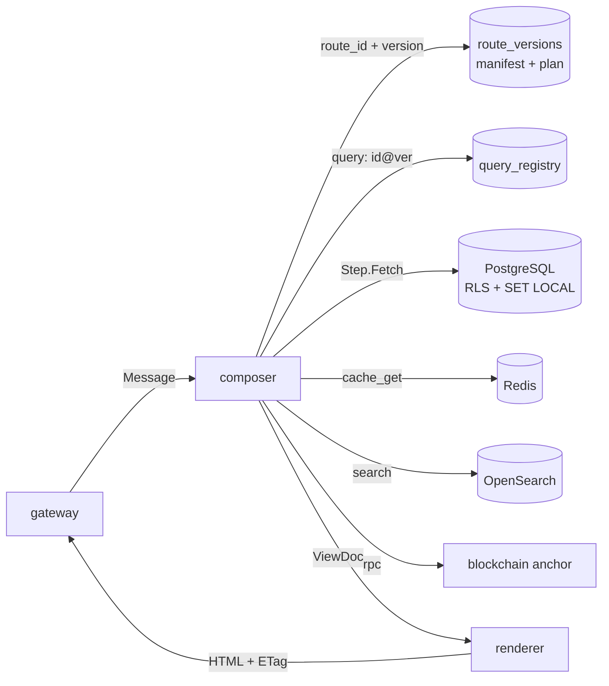
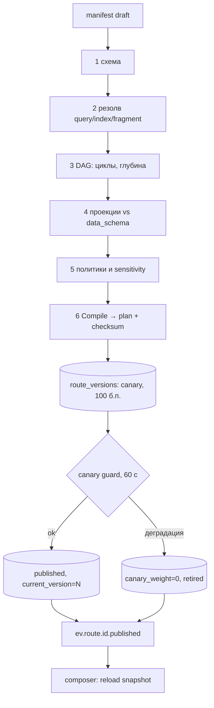
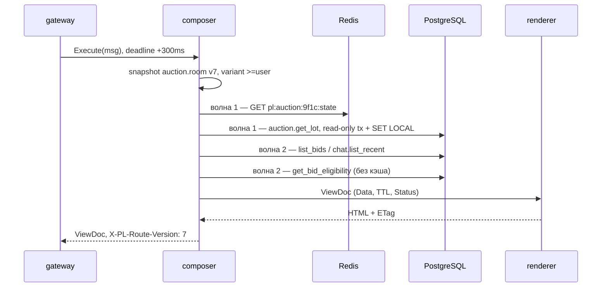

# 02. Маршруты данных: манифест в БД, исполнитель composer, права, кэш

> **Скоуп.** Как `composer` превращает декларативный манифест (§6 контракта) в `ViewDoc` (§5): модель БД,
> публикация версий, исполнение DAG, политики доступа, кэш шагов, производительность. **Не в скоупе:**
> транспорт и аутентификация (гл. 01), HTML-рендер (гл. 03), клиентские патчи (гл. 04), WS/SSE (гл. 05), денежные команды (гл. 07).
>
> Имена — строго из `00-contracts.md`. Маршрут **не содержит SQL** (§3.2), только `query: <registry_id>`.
> Исполнение — Go-код `composer`, а не PL/pgSQL; рендер — отдельный порт `Renderer` (§7); деньги — только
> HTTP-команды с `Idempotency-Key` (§3.5), `composer` физически не умеет писать (read-only пул, §5).
## 1. ADR-001. Маршрут — данные в БД, исполнение — Go-composer

**Решение.** Маршрут хранится в PostgreSQL как версионируемый манифест (§6) плюс нормализованные метаданные
шагов. `gateway` резолвит `RouteRef` (гл. 01), `composer` загружает ровно эту версию, компилирует манифест в DAG,
выполняет шаги через реестр именованных запросов, проверяет политики, собирает `DataSet` и `ViewDoc`.

**Почему.** (1) Тестируемость: манифест — данные, golden-тесты `Message → DataSet` идут без БД и релиза.
(2) Версионирование: версия — строка `route_versions`, canary/откат — `UPDATE` указателя; `RouteRef.Version`
и `Meta.RouteVersion` (§5) дают трассировку. (3) Наблюдаемость: шаг = OTel-спан и
`pl_route_step_duration_seconds{route,step}` (§10). (4) Безопасность: политики, проекции и лимиты — в одной
точке до SQL; RLS — вторая линия. (5) Мультиисточники: Redis/OpenSearch/S3/blockchain anchor — равноправные
узлы DAG. (6) Кэш: ключ шага из `(query, args, scopes)`, инвалидация по тегам не зависит от схемы БД.

**Отвергнутые альтернативы.**

| Альтернатива | Что даёт | Почему отвергнута |
|---|---|---|
| (а) PL/pgSQL-процедуры, собирающие данные в БД | один процесс, нет сети между шагами | БД становится сервисом: логика в миграциях, нет OTel-спанов, нет Redis/OpenSearch/anchor без FDW, соединение занято на весь маршрут → пул умирает при 1k RPS, `ViewDoc` собирать негде |
| (б) Захардкоженные BFF-хендлеры | быстро на 5 маршрутах | изменение блока = релиз; 40+ маршрутов × варианты `auth_level` — комбинаторный взрыв `switch`; canary только через feature-флаги |
| (в) GraphQL | гибкая выборка клиентом | клиент определяет стоимость запроса; HTTP/фрагментный кэш (§11) неприменим; SEO-страницам нужен серверный шаблон; field-level ACL — свой слой. Другая задача |
| (г) JSONPath по денормализованной документной БД | дешёвый старт | нет транзакционной консистентности с escrow/ставками, нет RLS, нет индексов под предикаты, денормализация расползается при мульти-магазинах |

**Последствия.** Манифест — «код без компилятора»: обязательны валидатор публикации (§3) и контрактные тесты
фрагментов (§9). `query_registry` надо ревьюить и версионировать. Загрузка снапшота при старте: 200 маршрутов
≈ 5–10 МБ JSON. «Поправить запрос на проде» нельзя — только новая версия + публикация.


## 2. Модель БД

Инвариант: **published/canary версии immutable** — изменение это новая строка `version + 1`; триггер
`BEFORE UPDATE` на `route_versions` меняет только `state`/`validation`/`plan`(NULL→значение). `route_steps` и
`route_variants` — производные от `manifest` (та же транзакция), нужны для impact-analysis и FK-защиты «нельзя удалить запрос, пока на него ссылаются маршруты».

```sql
CREATE TABLE policies (                                    -- RBAC-скоупы + ABAC-выражения
  id text PRIMARY KEY, area text NOT NULL, kind text NOT NULL,   -- 'catalog.read', 'auction.bid'
  expr text, description text NOT NULL, revision integer NOT NULL DEFAULT 1,
  CHECK (kind IN ('scope','abac')), CHECK (kind = 'scope' OR expr IS NOT NULL)
);
CREATE TABLE permissions (
  role text NOT NULL, scope text NOT NULL REFERENCES policies(id), PRIMARY KEY (role, scope)
);

CREATE TABLE routes (                                      -- идентичность и указатели версий
  id text PRIMARY KEY, status text NOT NULL DEFAULT 'draft',      -- 'product.page'
  current_version integer, canary_version integer,
  canary_weight integer NOT NULL DEFAULT 0,                       -- 0..10000 б.п.
  default_budget_ms integer NOT NULL DEFAULT 400, updated_at timestamptz NOT NULL DEFAULT now(),
  CHECK (status IN ('draft','published','retired')), CHECK (canary_weight BETWEEN 0 AND 10000)
);
CREATE TABLE route_versions (                              -- immutable манифест (§6)
  route_id text NOT NULL REFERENCES routes(id) ON DELETE CASCADE, version integer NOT NULL,
  state text NOT NULL, manifest jsonb NOT NULL, plan jsonb, checksum bytea NOT NULL, validation jsonb,
  published_at timestamptz, PRIMARY KEY (route_id, version)
);
CREATE UNIQUE INDEX route_versions_one_published ON route_versions (route_id) WHERE state = 'published';
CREATE UNIQUE INDEX route_versions_one_canary    ON route_versions (route_id) WHERE state = 'canary';

CREATE TABLE route_steps (                                 -- нормализованный DAG
  route_id text NOT NULL, version integer NOT NULL, step_id text NOT NULL,   -- 'load.bids'
  kind text NOT NULL,           -- sql|sql_batch|cache_get|search|blob|rpc|const|computed
  query_id text,                -- '<registry_id>@<ver>'
  args jsonb NOT NULL DEFAULT '{}', out_name text NOT NULL, optional boolean NOT NULL DEFAULT false,
  require_not_null boolean NOT NULL DEFAULT false,
  policy_id text REFERENCES policies(id), timeout_ms integer, max_rows integer,
  deps text[] NOT NULL DEFAULT '{}', PRIMARY KEY (route_id, version, step_id),
  FOREIGN KEY (route_id, version) REFERENCES route_versions(route_id, version) ON DELETE CASCADE
);
CREATE INDEX route_steps_by_query ON route_steps (query_id) WHERE query_id IS NOT NULL;

CREATE TABLE route_variants (
  route_id text NOT NULL, version integer NOT NULL, variant_id text NOT NULL,
  when_cond jsonb NOT NULL, steps text[],                    -- {auth_level: ">=user"}
  PRIMARY KEY (route_id, version, variant_id),
  FOREIGN KEY (route_id, version) REFERENCES route_versions(route_id, version) ON DELETE CASCADE
);

CREATE TABLE fragments_registry (                          -- контракты блоков (§6.3)
  id text NOT NULL, version integer NOT NULL, template text NOT NULL, data_schema jsonb NOT NULL,
  cache jsonb NOT NULL DEFAULT '{}', updates text[] NOT NULL DEFAULT '{}', state text NOT NULL DEFAULT 'active',
  PRIMARY KEY (id, version),
  CHECK (id ~ '^[a-z0-9_]+\.[a-z0-9_]+$')
);
CREATE UNIQUE INDEX fragments_registry_active ON fragments_registry (id) WHERE state = 'active';

CREATE TABLE query_registry (                              -- именованные запросы, единственный SQL
  id text NOT NULL, version integer NOT NULL, kind text NOT NULL,   -- sql|sql_batch|search
  sql text NOT NULL, args_schema jsonb NOT NULL, projection jsonb NOT NULL,
  sensitivity text NOT NULL, cache_ttl_ms integer NOT NULL DEFAULT 0,
  max_rows integer NOT NULL DEFAULT 100, state text NOT NULL DEFAULT 'active',
  checksum bytea NOT NULL, PRIMARY KEY (id, version), CHECK (sensitivity IN ('public','private','money')),
  CHECK (sensitivity = 'public' OR cache_ttl_ms = 0)          -- §3.7 на уровне схемы
);
CREATE UNIQUE INDEX query_registry_active ON query_registry (id) WHERE state = 'active';

CREATE TABLE idempotency_keys (                            -- команды (гл. 07), ключ из §10
  subject_id uuid NOT NULL, key text NOT NULL, route_id text NOT NULL,
  request_hash bytea NOT NULL, status text NOT NULL, response jsonb,
  created_at timestamptz NOT NULL DEFAULT now(), expires_at timestamptz NOT NULL,
  PRIMARY KEY (subject_id, key)
);
CREATE INDEX idempotency_keys_expires ON idempotency_keys (expires_at);
```
## 3. Публикация манифеста

Валидатор синхронный, отчёт — в `route_versions.validation`; ошибка → `state='rejected'`, версия не попадает в снапшот.

1. **Схема** `schemas/routes/route.v1.json`: структура §6.1, `budget_ms ≤ 2000`, `len(steps) ≤ 32`.
2. **Ссылки:** `query` есть в `query_registry` (`active`), `index` — в allowlist, `template` — в `fragments_registry`.
3. **DAG:** рёбра из `$steps.X.*`; цикл → reject (§6.2); глубина ≤ 6, ширина волны ≤ `MaxParallel`.
4. **Проекции:** поля из `data_schema` фрагмента (§6.3) обязаны входить в `projection` шагов — иначе reject.
5. **Данные:** `policy_id` существует; в `anonymous` нет `sensitivity != 'public'`; `ttl > 0` только для public.
6. **Компиляция:** `plan.Compile` → волны и лимиты; ошибка привязана к `step_id`.

**Canary.** Публикация → `state='canary'`, 100 б.п. (1 %). Версию выбирает резолвер `gateway` (гл. 01):
`xxhash64(route_id, subject_id|pl_cid) % 10000 < weight`, выбор стабилен. `workers` (`route.canary_guard`, 60 с)
сравнивает метрики с базовой версией; при error rate > 2× или p99 выше бюджета обнуляет вес → `retired` +
`ev.route.<id>.published`; откат вручную — `POST /internal/routes/{id}/rollback` (`AuthSigned`).

**Снапшот.** `composer` держит `atomic.Pointer[Snapshot]` на `(route_id, version)`: `{plan, fragments, budget}`;
загрузка — 2 строки + парсинг JSON (≈1 мс); инвалидация — NATS + TTL 30 с; холодная загрузка под `singleflight`.


## 4. Исполнение плана

`plan.Compile` — чистая функция `Manifest → Plan` (тестируется без БД): волны Кана, барьер между волнами;
`Step` — единственная точка расширения (SQL, Redis, OpenSearch, S3, blockchain — реализации интерфейса).

```go
type Step interface {
    ID() string; Dependents() []int; Optional() bool; OutName() string
    Fetch(ctx context.Context, rt *Runtime) (any, error)   // Runtime: tx, dataloader, policy, cache
}

func Compile(m manifest.Manifest, q QueryResolver) (*Plan, error) {
    steps, err := buildSteps(m.Steps, q); if err != nil { return nil, err }
    indeg := make([]int, len(steps))
    for i := range steps { indeg[i] = len(steps[i].Deps) }
    var waves [][]int
    for done := 0; done < len(steps); {
        var wave []int
        for i := range steps { if indeg[i] == 0 { wave = append(wave, i); indeg[i] = -1 } }
        if len(wave) == 0 { return nil, ErrCycle }            // дублирует валидатор §3
        for _, i := range wave { for _, n := range steps[i].Dependents() { indeg[n]-- } }
        waves = append(waves, wave); done += len(wave)
    }
    return &Plan{Steps: steps, Waves: waves, Limits: m.Limits, Budget: m.Budget}, nil
}
```

Семафор ограничивает параллелизм, но **не** меняет состав волны: барьер нужен, иначе аргументы следующей
волны не готовы. Дедлайн — `min(Meta.Deadline, now+budget_ms, parent)` (§3.6).

```go
func Run(ctx context.Context, p *plan.Plan, msg message.Message, d Deps) (*view.ViewDoc, error) {
    ctx, cancel := context.WithDeadline(ctx, minTime(msg.Meta.Deadline, time.Now().Add(p.Budget)))
    defer cancel()
    ds, degraded := NewDataSet(len(p.Steps)), map[string]bool{}
    sem := semaphore.NewWeighted(int64(p.Limits.MaxParallel))
    for _, wave := range p.Waves {
        g, gctx := errgroup.WithContext(ctx)
        for _, idx := range wave {
            if err := sem.Acquire(gctx, 1); err != nil { return nil, err }
            g.Go(func() error {
                defer sem.Release(1)
                st := p.Steps[idx]
                v, err := st.Fetch(gctx, NewRuntime(ds, msg, d))
                if err != nil {
                    if st.Optional() { degraded[st.ID()] = true; return nil }   // → degraded, не 503
                    return fmt.Errorf("step %s: %w", st.ID(), err)
                }
                ds.Set(st.OutName(), v); return nil
            })
        }
        if err := g.Wait(); err != nil { return nil, err }
    }
    return assemble(p, msg, ds, degraded), nil
}
```

Необязательный шаг не отменяет группу; `require: not_null` при пустом результате — `resource.not_found` (404).
**Dataloader.** Лента: 8 товаров, у каждого магазин; наивно — 8 запросов, а шаг не порождает шаги. `sql_batch`:
окно склейки 1 мс, `ANY($1)`, лимит массива 200 → один запрос ~2 мс вместо ~12 мс.

```go
func (l *ShopLoader) LoadMany(ctx context.Context, ids []string) (map[string]domain.Shop, error) {
    out, missing := map[string]domain.Shop{}, dedupe(ids)
    if s, ok := l.cache.GetMany(missing); ok { return s, nil }   // локальный кэш шага
    got, err := l.batcher.Add(missing).Wait(ctx)                  // склейка вызовов в окне 1 мс
    if err != nil { return nil, err }
    return got, nil                                               // SELECT id, ... WHERE id = ANY($1)
}
```

**Лимиты** (публикация + рантайм): `max_steps=32`, `max_parallel=8`, `max_rows ≤ 500` из реестра
(превышение → `internal`, не усечение), `max_bytes=1.5 МБ` на `DataSet`, fan-out только `sql_batch` ≤ 200.
## 5. Права доступа

**ADR-009. Права трёхуровнево: policy → RLS → column projection.** Правила считает `composer`, deny-by-default.
*Почему:* `gateway` не знает шагов, `renderer` получает данные поздно, БД не видит `Message`/ABAC; RLS — страховка
от нового запроса без `WHERE`. *Отвергнутые альтернативы:* проверки только в `gateway` и только в SQL-представлениях —
отвергнуты (нет ABAC и вариантов `auth_level`). *Последствия:* один вызов движка на шаг с `policy_id`.

- **RBAC:** `permissions(role → scope)`; `gateway` собирает `AuthContext.Scopes` (кэш `pl:sess:<sid>`); ban инвалидирует сессию → `Scopes` пуст.
- **ABAC:** `Subject.{ID,Roles,ShopIDs,Level,Verified}` (§4) + факты строки, CEL (`cel-go`):
  `shop.manage` → `subject.verified && subject.shop_ids.exists(id, id == facts.shop_id)`;
  `admin.registry` → `subject.roles.exists(r, r in ['moderator','admin'])`. AST компилируется при публикации.
- **Deny-by-default:** нет scope → `auth.forbidden` 403 (§8) до SQL.

**Row-level.** Каждый SQL-шаг — короткая read-only транзакция с `SET LOCAL`:

```go
tx, _ := pool.BeginTx(ctx, pgx.TxOptions{AccessMode: pgx.ReadOnly})
_, err := tx.Exec(ctx, `SELECT set_config('app.user_id',$1,true), set_config('app.roles',$2,true)`,
    a.Subject.ID, strings.Join(a.Subject.Roles, ","))      // true = SET LOCAL, живёт до COMMIT
```

```sql
ALTER TABLE products ENABLE ROW LEVEL SECURITY;
ALTER TABLE products FORCE ROW LEVEL SECURITY;          -- владелец таблицы тоже под RLS
CREATE POLICY products_read ON products FOR SELECT USING (
  status = 'available'
  OR EXISTS (SELECT 1 FROM shops s WHERE s.id = products.shop_id
             AND s.user_id = nullif(current_setting('app.user_id', true), '')::uuid)
  OR current_setting('app.roles', true) ~ '(^|,)(admin|moderator)(,|$)'
);
CREATE INDEX shops_user_idx ON shops (user_id);         -- под EXISTS в политике
```

`composer` — роль `pl_composer` только с `SELECT` и `default_transaction_read_only=on`. Стоимость — подзапрос
на строку; предикат начинается с дешёвого `status`, `EXISTS` идёт по PK/индексу, план — под EXPLAIN-гейтом.

**Column-level.** `query_registry.projection` — явный список полей по уровню доступа (`SELECT *` запрещён,
`*` разворачивается на публикации). Пример:
`{"id":"users.get_viewer_flags","sensitivity":"private","projection":{"public":[],"owner":["user_id","in_watchlist","has_bid","can_bid","wallet_available"]}}`.
`private|money` — только варианты `>=user`/`owner` и фрагменты с `ttl=0`; denylist (`password_hash`, `email`,
`phone`, чужой `wallet_balance`/`escrow_balance`, модерация) проверяется в CI; после шага строки режутся
по проекции (dev — `panic`, prod — `internal`).

**Варианты и кэш.** Выбор из `match.variants` по `Subject.Level`: `admin > owner > >=user > anonymous`; `variant_id` — в span/лог. `anonymous` → CDN,
`public, s-maxage=30`; `>=user/owner` → `private, no-store` и кэш шага по `hash(scopes)`; `admin` — без кэша (§3.7).

**Тесты на утечки.** Golden `ViewDoc` анонимных вариантов без полей denylist; property-тест
`applyProjection` не пропускает лишних колонок; RLS-тест «чужой `app.user_id` → 0 черновиков»;
`pg_query_go`-парсер всех SQL падает на `SELECT *`, DML/DDL, конкатенации параметров.
## 6. Кэш данных

**ADR-008. Кэш данных шага: ключ со scopes, TTL/SWR, инвалидация по тегам.** Слой — `pl:cache:step:`.
*Почему:* HTML-кэш (`renderer`) не переживает изменение одного блока, CDN не знает прав, кэш от данных
переиспользуется между вариантами маршрута. *Отвергнутые альтернативы:* кэш целого `ViewDoc` (ломается при точечных
патчах), материализованные представления (миграция на каждое изменение), кэш «по URL» (смешивает
`auth_level`) — отвергнуты. *Последствия:* у каждого запроса честный TTL и теги; приватные и денежные
данные не кэшируются вообще.

Ключ (§10, §11): `pl:cache:step:<hash>`, `hash = sha256(canonical(query_id@version, args, scopes, locale))[:24]`;
версия в ключе — естественная инвалидация при публикации. Значение — конверт `{v: msgpack, tags, row_ver, exp}`.

- **TTL/SWR.** `ttl` из `query_registry.cache_ttl_ms` (манифест уменьшает, не увеличивает; потолок 300 с).
  `stale_for = min(2×ttl, 120s)`: просроченное отдаётся сразу, ревалидация — в фоне под `singleflight`,
  `ViewMeta.Cache = "hit"`; упавшая ревалидация — stale до конца окна, затем miss.
- **Версия строки.** В конверте `max(updated_at)`; для горячих одиночных запросов (лот) — режим
  `validate: row_version`: индексный `SELECT updated_at WHERE id = $1` перед отдачей. `xmin` отвергнут: `VACUUM FREEZE` его меняет, между репликами нестабилен.
- **Теги.** Писатель в той же транзакции пишет outbox с тегами (`product:<id>`, `auction:<id>`); `workers`
  публикует `ev.cache.purge`; `composer` держит Set `pl:cache:tag:<tag>` и удаляет ключи пачками по 500.
  Best-effort + TTL как страховка; SLA инвалидации — `pl_outbox_lag_seconds` (§10). Префикс `pl:cache:tag:` —
  аддитивное расширение семейства `pl:cache:` (§10), фиксируется в v2 контракта.
- **Запреты (§3.7).** `sensitivity != 'public'` → `cache_ttl_ms = 0` (CHECK в §2): баланс, escrow, право
  ставки, идемпотентность, сессия, модерация. Такие ответы — `Cache-Control: private, no-store`.
- **Thundering herd.** `singleflight` по ключу, jitter TTL ±10 %; при отказе Redis — прямой поход в БД с урезанным бюджетом и circuit breaker: деградация, не 500.
- **Negative caching.** «Не найдено» — 3–5 с с теми же тегами, только для публичных 404
  (`resource.not_found`). 403 и приватные «не найдено» не кэшируются: иначе оракул перебора slug.
## 7. Производительность

- **Пул pgx:** `MaxConns=12`, `MinConns=4`, `MaxConnLifetime=30m`; `instances × MaxConns ≤ 0.7 × max_connections`
  (6 инстансов → 72 из 200). Отдельный пул для `private|money`: публичный трафик не ест соединения приватных проверок.
- **Statement cache:** `QueryExecModeDescribeExec`, `StatementCacheCapacity=256`; подготовка лениво по
  `(query_id@version)`. PgBouncer в transaction-режиме → `simple_protocol` и `StatementCacheCapacity=0`.
- **Транзакция шага:** `SET LOCAL statement_timeout = <timeout шага>`, `lock_timeout = '200ms'`,
  `default_transaction_read_only = on`, `idle_in_transaction_session_timeout = '5s'`.
- **Индексы под маршруты** (лента, карточка, комната аукциона, дашборд продавца):

```sql
CREATE INDEX products_feed_idx ON products (published_at DESC, id DESC) WHERE status = 'available';
CREATE UNIQUE INDEX products_slug_key ON products (slug);
CREATE INDEX auction_bids_room_idx ON auction_bids (auction_id, created_at DESC, bid_id DESC);
CREATE INDEX chat_messages_room_created_idx ON chat_messages (room_id, created_at DESC, msg_id DESC);  -- `seq` — номер топика в транспорте, в БД его нет (05 §5.5)
CREATE INDEX orders_shop_status_idx ON orders (shop_id, status, created_at DESC);
```

- **EXPLAIN-гейт в CI:** на seed-данных (≥100k `products`, `auction_bids`) снимается `EXPLAIN (FORMAT JSON)`;
  падение при `Seq Scan` по таблице > 50k строк, расхождении `rows` > ×3, `Nested Loop` с внешним Seq Scan. Golden-план в `testdata/plans/`, diff блокирует PR.
- **Перегрузка:** насыщение пула → 503 `upstream.timeout` с `Retry-After` (не 500).
## 8. Сквозной маршрут `auction.room`

Комната аукциона: hot-state из Redis (`pl:auction:<id>:state`), история ставок и чат из PostgreSQL, право ставки — приватный шаг.

```yaml
id: auction.room
version: 7
status: published
match:
  methods: [GET]
  path: /auction/{id}
  variants:
    - {when: {auth_level: anonymous}, steps: [load.hot, load.lot, load.bids, load.chat]}
    - {when: {auth_level: ">=user"}, steps: [load.hot, load.lot, load.bids, load.chat, load.viewer]}
defaults: {budget_ms: 300, cache: {ttl: 5s, vary: [auth_level]}}
steps:
  - {id: load.hot, kind: cache_get, key: "pl:auction:$params.id:state", out: hot, optional: true}  # промах → пересчёт из PG (05 §5.7), 404 только по load.lot
  - {id: load.lot, kind: sql, query: auction.get_lot, args: {id: "$params.id"}, out: lot, policy: catalog.read, require: not_null}
  - {id: load.bids, kind: sql, query: auction.list_bids, args: {auction_id: "$params.id", limit: 20}, out: bids, max_rows: 20, optional: true}
  - {id: load.chat, kind: sql, query: chat.list_recent, args: {room_id: "$steps.lot.chat_topic", limit: 50}, out: chat, optional: true}
  - {id: load.viewer, kind: sql, query: wallet.get_bid_eligibility, args: {user_id: "$auth.subject.id", auction_id: "$params.id"}, out: viewer, optional: true, policy: wallet.read}
fragments:
  - {id: auction.lot_card, template: fragments/auction/lot_card, bind: {lot: "$steps.lot", hot: "$steps.hot"}, cache: {ttl: 5s, tag: "auction:$steps.lot.id"}}
  - {id: auction.bid_stack, template: fragments/auction/bid_stack, bind: {bids: "$steps.bids", hot: "$steps.hot", viewer: "$steps.viewer"}, cache: {ttl: 1s, tag: "auction:$steps.lot.id"}}
  - {id: auction.chat, template: fragments/auction/chat, bind: {messages: "$steps.chat", topic: "$steps.lot.chat_topic"}, cache: {ttl: 2s, tag: "chat:$steps.lot.chat_topic"}}
  - {id: auction.buyer_panel, template: fragments/auction/buyer_panel, bind: {viewer: "$steps.viewer", hot: "$steps.hot"}, optional: true}
page: {template: pages/auction, slots: [auction.lot_card, auction.bid_stack, auction.chat, auction.buyer_panel]}
```

```sql
SELECT a.id, a.product_title, a.images_urls, a.stream_url, a.start_price, a.min_step,       -- get_lot, ttl 3s
       a.current_price, a.ends_at, a.status, a.variety_id, a.chat_topic,
       u.id AS seller_id, u.username AS seller_username, u.rating AS seller_rating
FROM auctions a JOIN users u ON u.id = a.user_id WHERE a.id = $1;

SELECT b.bid_id, b.amount, b.created_at, left(u.username, 2) || '***' AS bidder,        -- list_bids, ttl 1s
       (b.blockchain_block_tx IS NOT NULL) AS anchored
FROM auction_bids b JOIN users u ON u.id = b.user_id
WHERE b.auction_id = $1 ORDER BY b.amount DESC, b.created_at DESC LIMIT $2;

SELECT m.msg_id, m.user_id, u.username, u.display_name, m.body, m.created_at,         -- list_recent, ttl 2s
FROM chat_messages m JOIN users u ON u.id = m.user_id
WHERE m.room_id = $1 ORDER BY m.created_at DESC, m.msg_id DESC LIMIT $2;

SELECT u.wallet_balance, u.escrow_balance, a.min_step,                     -- get_bid_eligibility, ttl 0
       a.current_price + a.min_step AS next_min_bid,
       (u.wallet_balance >= a.current_price + a.min_step) AS can_bid
FROM users u JOIN auctions a ON a.id = $2 WHERE u.id = $1;
```

Два решения: персональное — не в SQL кэшируемого запроса (`user_id` в `WHERE` убивает кэш и матрицу вариантов);
`can_bid` совещательный — `current_price` в БД отстаёт от hot-state, финальную проверку делает команда
`POST /v1/auctions/{id}/bids` в транзакции + Lua CAS (§3.5, §3.8).

Сборка `ViewDoc` (HTML и `ETag` добавляет `renderer` по §10):

```go
func assemble(p *plan.Plan, msg message.Message, ds DataSet, degraded map[string]bool) *view.ViewDoc {
    doc := &view.ViewDoc{RequestID: msg.Meta.RequestID, Route: msg.Route,
        Meta: view.ViewMeta{RouteVersion: p.Version}}
    for _, fs := range p.Fragments {
        f := view.Fragment{ID: fs.ID, Version: fs.Version, TTL: int(fs.TTL.Seconds())}
        raw, err := fs.BindJSON(ds)
        switch {
        case degraded[fs.StepID]: f.Status = view.FragDegraded
        case err != nil: f.Status = view.FragError
        case len(raw) > 0: f.Status, f.Data = view.FragOK, raw
        default: f.Status = view.FragEmpty
        }
        if f.Status == view.FragDegraded { doc.Meta.Degraded = append(doc.Meta.Degraded, f.ID) }
        doc.Fragments = append(doc.Fragments, f)
    }
    return doc
}
```


## 9. Тестирование

- **Golden DataSet:** `testdata/routes/<route>/{anon,user,admin}.golden.json`; шаги (pgxmock/redismock) →
  `DataSet` → `ViewDoc`, diff — осознанное решение. Все published-маршруты × варианты.
- **Контракт фрагментов:** каждый `bind` валидируется против `data_schema` (`santhosh-tekuri/jsonschema/v6`,
  draft 2020-12); CI падает при расхождении — §6.3 соблюдается автоматически.
- **Fuzz аргументов:** `-fuzz=FuzzStepArgs`: пустые/1 МБ/неверный тип/омоглифы → `validation.failed` 400 (§8),
  без паник и запросов в БД; лимит 4 КБ режет `gateway` (§4 «нормализация»).
- **Бенчмарки:** `BenchmarkAuctionRoom` — 1k RPS на инстанс, p99 < 120 мс, degraded = 0; ночной прогон `-benchtime=30s` + профиль аллокаций (< 40 КБ/запрос).
- **Публикация/canary:** «плохие» манифесты (цикл, несуществующий query, проекция без поля, `ttl>0` при `money`) → `rejected`; откат возвращает трафик одним `UPDATE`.
## Риски и что сломается первым

1. **Валидатор отстаёт от манифеста:** новый `kind` проходит схему, но не компилируется → 503 на проде. Митигация: canary + «dry-run compile» всех published-версий в CI.
2. **RLS и пул:** `SET LOCAL` вне транзакции или потеря настроек на переиспользованном соединении дают
   утечку чужих строк или пустые ответы. Митигация: единственный путь — `withStepTx`, тест «не протекает».
3. **Пропущенная инвалидация:** потерянный outbox-эвент → устаревшая цена/статус до TTL. Митигация: TTL ≤ 60 с
   для мутируемых данных, `pl_outbox_lag_seconds` в алертах, tag-индекс как дешёвый дубль.
4. **Один тяжёлый запрос в реестре** валит p99 всего `composer` (общий пул). Митигация: раздельные пулы по `sensitivity`, `statement_timeout`, `max_rows`, EXPLAIN-гейт.
5. **Canary по клиенту + фрагментный кэш:** пользователь «скачет» между версиями и получает несовместимые
   ETag/HTML. Митигация: sticky по `pl_cid`, версия маршрута в ключе фрагментного кэша.
6. **Рассинхронизация `manifest` и нормализованных таблиц:** соблазн править `route_steps` руками.
   Митигация: триггер «только чтение для published» + nightly-сверка «manifest → таблицы».
## Открытые вопросы

1. Где брать ABAC-атрибуты, которых нет в `Subject` (бан, участие в аукционе, «организатор лота»)?
   Варианты: аддитивное `Subject.Attrs` в v2 контракта или снапшот из `pl:sess:<sid>` в `composer`.
2. Хранить ли скомпилированный `plan` в БД (сейчас да — аудит и дифф) или компилировать на загрузке: влияет на размер и на дрейф версии компилятора между инстансами.
3. Кто владеет `query_registry` — доменные команды или платформа? От этого зависит SLA ревью и скорость изменения маршрутов (предложение: домен пишет, платформа ревьюит).
