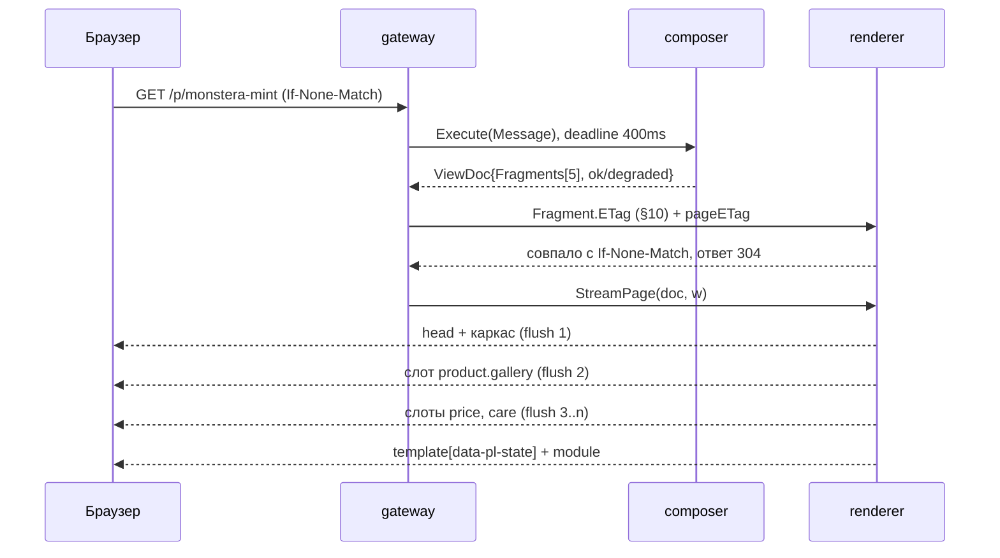

# 03. Сервис рендера: fragment registry, шаблоны, стриминг

> Опирается на `00-contracts.md`: §5 `ViewDoc`, §6.3 контракт фрагмента, §7 порт `Renderer`, §8 ошибки,
> §10 имена и ETag, §11 кэш-матрица. Имена сервисов и типов не переопределяются.

## 3.1. Роль и границы

`renderer` — детерминированный преобразователь `ViewDoc → HTML`. Решения приняты раньше: маршрут и права —
`composer` (гл. 02), `seq` и доставка — `hub` (гл. 05). Состояния между запросами нет; осознанно запрещены:
форматирование денег (ADR-03-02), санитайз UGC «на лету» (§3.7), выбор данных по правам, вычисление `degraded`.

| Свойство | Значение |
|---|---|
| Вход | `*view.ViewDoc` (§5); дедлайн — из `context` (он же `Message.Meta.Deadline`) |
| Выход | `[]byte` для порта §7; поток байт для `StreamPage` (§3.6) |
| Внешние вызовы | нет: ни БД, ни S3, ни Vision-LLM |
| Состояние | только кэш HTML фрагментов: `pl:cache:frag:<id>:<hash>` (§11) |

## 3.2. Зачем серверный рендер

1. **Индексация.** Карточка сорта, лот, профиль магазина — входы из поиска. Бот (`Meta.UAClass = bot`, §4)
   получает тот же HTML, что человек, плюс JSON-LD в голове; рендер на клиенте дал бы боту пустой first paint.
2. **Первый экран на 3G.** LCP ≤ 2.5 с на Slow 4G при ≤ 45 KB gzip достижим только если первый байт содержит
   название и цену, а не `<div id="root">`.
3. **Работа без JS.** Навигация — обычные ссылки, ставка — обычный `POST` с `303 See Other` (PRG).
   Вахтёрский тест: сценарий, не работающий без JS, сломан, а не «не поддержан».
4. **CSP без `unsafe-inline`/`unsafe-eval`.** Нет inline-обработчиков и JSON-в-JS; шаблон исполняется на
   сервере, клиент морфит готовый HTML (гл. 04).

## 3.3. ADR-03-01: шаблонизатор

**Решение.** Единственный HTML-шаблонизатор — templ (a-h/templ): компонент = Go-функция с типизированными
аргументами, генерирующая код на этапе сборки (без Node в пайплайне бэкенда).

**Почему.**
- Компиляция: «шаблон ждёт поле — bind его не дал» = ошибка сборки, а не 500 в проде. Это реализация §6.3
  на уровне типов, а не только тестов.
- Нет парсинга шаблона в рантайме: p99 рендера предсказуем (конкатенация строк в `io.Writer`).
- `templ.Component` — значение: слоты, layout и «тот же фрагмент в страницу и в AJAX» собираются как
  Go-структуры, без строковых `define`.
- `Render(ctx, w)` проносит контекст до границы слота (§3.10).

**Отвергнуто.** `html/template` — контекстное экранирование хорошее, но типизации нет: `missingkey=error`
ловит отсутствующие ключи map, а не неверные поля структуры; registry и слоты пришлось бы строить на строках.
Node/React SSR — второй рантайм и билд, дублирование типов, +40–80 MB RSS на воркер, и шаблон не проверяется
против `data_schema`. WASM-SSR — 1.5–4 MB рантайма, незрелая отладка, нет выигрыша по латентности.

**Последствия.** `templ generate` в CI, `*_templ.go` в репозитории (ревью, diff). Дизайнер не правит HTML напрямую —
митигация: preview-стенд на фикстурах; правка шаблона = деплой (осознанно: артефакт версионируется с registry).

## 3.4. Fragment registry

### 3.4.1. Две половины одного реестра

Адрес блока — `id → {template, version, data_schema, cache, updates}` ровно по §6.3. Реестр состоит из двух частей: **код**
(`internal/render/fragments/<area>/<name>/v<N>_templ.go` + структура из JSON Schema) — истина для рендера; **метаданные**
(`render.fragment_contract`, синхронизируется командой `renderer registry sync`) — истина для валидации, кэша и подписок.
БД нужна, чтобы `gateway` знал допустимые `updates` при подписке, а манифест ссылался на версию контракта; TTL и `vary` —
тоже здесь (§11).

```sql
CREATE SCHEMA IF NOT EXISTS render;

CREATE TABLE render.fragment_contract (
    fragment_id    text        NOT NULL,               -- 'product.price'
    version        integer     NOT NULL,               -- Fragment.V (§5)
    template_path  text        NOT NULL,               -- 'fragments/product/price'
    data_schema    jsonb       NOT NULL,               -- JSON Schema draft 2020-12 (§6.3)
    schema_sha256  bytea       NOT NULL,
    code_sha256    bytea       NOT NULL,               -- хэш сгенерированных *_templ.go
    cache_ttl_s    integer     NOT NULL DEFAULT 0 CHECK (cache_ttl_s >= 0),
    cache_vary     text[]      NOT NULL DEFAULT '{}',  -- {locale,currency,auth_level}
    cache_tag_tmpl text,                               -- 'product:{product.id}'
    updates        text[]      NOT NULL DEFAULT '{}',  -- {signal,fragment.replace,state.patch}
    status         text        NOT NULL DEFAULT 'active'
                               CHECK (status IN ('active','retired')),
    published_at   timestamptz NOT NULL DEFAULT now(),
    PRIMARY KEY (fragment_id, version)
);

CREATE INDEX fragment_contract_active_idx
    ON render.fragment_contract (fragment_id) INCLUDE (version, cache_ttl_s)
    WHERE status = 'active';
```

В памяти — `atomic.Pointer[map[string]Entry]`; загрузка на старте (`WHERE status='active'`) и hot-reload по
NATS `ev.registry.fragment.published` (паттерн §10 `ev.<domain>.<entity>.<action>`), fallback — refresh
раз в 60 с. Держатся текущая и предыдущая версии каждого блока.

### 3.4.2. Версия контракта блока

- `Fragment.Version` (§5) — версия **data-контракта**, не кода: шаблон может меняться без смены версии.
- Новое необязательное поле — та же версия (шаблон игнорирует лишнее). Удаление/смена типа — новая версия;
  старая получает `status='retired'` и живёт 30 дней, чтобы страницы из CDN-кэша продолжали рендериться.
- Нет `(id, version)` из `ViewDoc.Fragment.Version` в registry → `Fragment.Status = error` (§5): клиент
  сохраняет старый блок, страница остаётся 200, метрика `pl_fragment_degraded_total{fragment}`, лог с
  `request_id`. Рассинхрон лечится деградацией блока, а не 500 на страницу (§8).

### 3.4.3. Валидация на CI

`cmd/registry-check` — блокирующий шаг (exit 1):
1. `data_schema` компилируется как draft 2020-12 (`santhosh-tekuri/jsonschema/v6`), корень `additionalProperties: false`.
2. Хэши схемы и сгенерированного кода совпадают с записанными в registry; каждый `data-pl-fragment="<id>"` в `.templ` есть
   в registry, и наоборот (сирота = ошибка).
3. `updates ⊆ {signal, fragment.replace, state.patch}` (§9); golden-рендер для `(фрагмент × locale × currency)`
   без расхождений и в бюджете (§3.10); `git grep templ.Raw\|template.HTML` пуст, кроме `//safe:`.

## 3.5. Контракт данных: bind → struct

### ADR-03-02: деньги форматируются до рендера

**Решение.** `Fragment.Data` содержит и машинное, и presentation-представление: `amount_minor` (int64,
копейки) и `amount_text` («12 490 ₽»). Форматирует `computed`-шаг манифеста (§6.2) в `composer` через
`golang.org/x/text/message` + `currency`: семантика как у `Intl.NumberFormat("ru-RU",{style:"currency",
currency:"RUB"})`, но источник — сервер.

**Почему.** (1) В `ViewDoc` нет `locale` (§5 заморожен), а порт §7 отдаёт рендереру только документ —
иначе рендерер начнёт читать cookie. (2) Ключ кэша — `hash(data,locale,currency)` (§11), ETag —
`sha256(data|locale|currency)` (§10): локализованные строки внутри `Data` делают кэш и ETag корректными
автоматически. (3) Клиент не форматирует цены вообще (инвариант §3.8).

**Отвергнуто.** Поле `Locale` в `ViewDoc` — ломающее изменение замороженного типа (нужна v2 контракта); форматирование в
шаблоне по культуре из контекста теряется в ETag и кэше; на клиенте — запрещено инвариантом.

**Последствия.** `computed`-шаги становятся частью контракта данных, их ошибки видны как `degraded`.
`ui.locale`/`ui.currency` кладутся в `ViewDoc.State` как конвенция ключей (тип не меняется) и дают
`<html lang>`, `hreflang` и `Vary` (§3.8). Конвенцию закрепить с гл. 02 — «Открытые вопросы».

### ADR-03-03: расхождение data-контракта в рантайме

**Решение.** Обязательные поля проверяются при декодировании; несоответствие → `degraded` + skeleton, не 500.
Полная валидация по JSON Schema — только в тестах/golden и на staging (`RENDER_STRICT_DATA=1`, семпл 1 % на
проде для статистики).

**Почему.** Полная валидация — 0.3–1.2 мс на блок, ×12 = заметно в бюджете 400 мс (§6.1). 500 из-за одного поля нарушает
принцип деградации (§8); молчаливые zero-values хуже («0 ₽» — ложь клиенту, инвариант §3.8). **Отвергнуто:** паника
(теряется весь HTML), пустой блок без статуса, валидация на каждом запросе.

**Последствия.** SLO degraded-доли < 0.1 %; structured-лог с сырым `Fragment.Data` (фильтр PII); трасса
`request_id` → сохранённый `ViewDoc` (семпл) для воспроизведения.

```go
// internal/render/fragment/price.go
//go:generate go-jsonschema -p fragment -o price_gen.go schemas/fragments/product.price.v3.json

type PriceData struct {
	AmountMinor int64  `json:"amount_minor"` // копейки: для JSON-клиентов и тестов
	AmountText  string `json:"amount_text"`  // '12 490 ₽': отформатировано computed-шагом
	Currency    string `json:"currency"`     // 'RUB'
	IsAuction   bool   `json:"is_auction"`
	EndsAtMS    int64  `json:"ends_at_ms,omitempty"` // абсолютное время, мс UTC (не таймер!)
}

func decodePrice(raw json.RawMessage) (PriceData, error) {
	var d PriceData // unknown fields игнорируем: добавление поля не требует новой версии
	if err := json.Unmarshal(raw, &d); err != nil {
		return d, fmt.Errorf("price v3: unmarshal: %w", err)
	}
	if d.AmountText == "" || d.Currency == "" || d.AmountMinor < 0 {
		return d, fmt.Errorf("price v3: missing required field") // → degraded, не 500
	}
	return d, nil
}

// templ-компонент: сигнатура ровно от data-контракта, никаких map[string]any
templ Price(d PriceData) {
	<div class="pl-price" data-pl-fragment="product.price">
		<span class="pl-price__value">{ d.AmountText }</span>
		if d.IsAuction {
			<span class="pl-price__hint">аукцион, до { formatEndsAt(d.EndsAtMS) }</span>
		}
	</div>
}
```

## 3.6. Сборка документа: layout, слоты, стриминг

**Layout** — `pages/layout.templ`: `<html lang>`, `<head>` (title, canonical, JSON-LD, preload модуля) и
каркас `header/nav/main/footer`, который не меняется при навигации (на это опирается гл. 04 §4.4).

**Слот** — один элемент-обёртка, по нему клиент адресует блок; обязательные атрибуты `data-pl-fragment`, `data-pl-v`,
`data-pl-etag`. Компонент рендерится внутрь — `Mode` (§9) меняет только содержимое.

Порядок — `Page.Fragments` (§5) = `page.slots` манифеста (§6.1); рендерер **не сортирует**.

**Один фрагмент — два пути.** `layout.Page(doc)` для страницы, `RenderFragments(doc, ids)` для AJAX — тот же компонент.
Правило ответа (с гл. 01): один фрагмент + `Accept: text/html` → HTML и `ETag`; несколько → `application/json` с
`ViewDoc` (§5), HTML в `Fragments[].HTML`. Второго набора шаблонов не существует.

**Стриминг.** Честная рамка: данные уже собраны. Стриминг байтовый — голова и каркас уходят раньше тяжёлых блоков
(`product.similar` с 8 карточками: 6–10 мс работы шаблона); на 3G это 300–600 мс до LCP. Флаши: head → каркас → слоты →
хвост с `<template data-pl-state>` (не `<script type="application/json">`: меньше вопросов к CSP).



Стриминг — метод `*renderer.Service`, а не расширение порта §7: сами шаблоны одни и те же.

```go
func (s *Service) StreamPage(ctx context.Context, doc *view.ViewDoc, w http.ResponseWriter) error {
	comp, ok := s.registry.Layout(doc.Page.Template)
	if !ok {
		return fmt.Errorf("render: unknown layout %q", doc.Page.Template)
	}
	degraded := make([]string, 0, 2)
	for i := range doc.Fragments {
		f := &doc.Fragments[i]
		f.ETag = fragmentETag(*f, doc.State) // §10: нужен до первого байта — для 304
		if f.Status == view.FragDegraded || f.Status == view.FragError {
			degraded = append(degraded, f.ID)
		}
	}
	h := w.Header()
	h.Set("Content-Type", "text/html; charset=utf-8")
	h.Set("X-PL-Route", doc.Route.ID)
	h.Set("X-PL-Route-Version", strconv.Itoa(doc.Route.Version))
	if len(degraded) > 0 {
		h.Set("X-PL-Degraded", strings.Join(degraded, ",")) // §8: до тела, набор уже известен
	}
	h.Set("ETag", pageETag(doc))
	bw := bufio.NewWriterSize(w, 8<<10)
	rc := http.NewResponseController(w)
	if err := comp.Render(ctx, &flushWriter{w: bw, rc: rc}); err != nil {
		return err // соединение открыто: логируем, клиент получит обрезанный документ
	}
	return bw.Flush()
}
```

```go
// Порт §7: байтовые варианты для hub/workers и JSON-клиентов (те же шаблоны, без layout).
func (s *Service) RenderPage(ctx context.Context, doc *view.ViewDoc) ([]byte, error) {
	var buf bytes.Buffer
	err := s.render(ctx, doc, nopFlusher{&buf}) // nopFlusher: flush — no-op
	return buf.Bytes(), err
}

func (s *Service) RenderFragments(ctx context.Context, doc *view.ViewDoc, ids []string) (map[string][]byte, error) {
	out := make(map[string][]byte, len(ids))
	for _, id := range ids {
		f, ok := doc.Fragment(id)
		if !ok || f.Status == view.FragError {
			continue // клиент оставит текущий HTML (§9)
		}
		var b bytes.Buffer
		if err := s.renderFragment(ctx, f, &b); err != nil {
			continue // деградируем блоком, а не всем ответом (§8)
		}
		out[id] = b.Bytes()
	}
	return out, nil
}
```

## 3.7. Безопасность

- **Автоэкранирование.** templ экранирует текст и атрибуты; URL — только через `templ.URL`/`templ.SafeURL`. Правило:
  ни одно пользовательское значение не попадает в контекст `<script>`/`<style>` — всё нужное клиенту в `data-*` и `<template>`.
- **UGC** (описания сортов, чат, названия магазинов): санитайз на записи (гл. 02/05), в БД `*_html_sanitized` рядом с
  `*_src_hash`; рендер доверяет только `*_sanitized` и прогоняет `bluemonday` на промахе кэша. Allowlist:
  `p,br,strong,em,ul,ol,li,blockquote,a[href]`; `img` запрещён; `target` вырезается, `rel="nofollow ugc noopener"` принудительно.
- **CSP.** Кэшируемая страница без nonce (иначе один nonce разъедется по всем клиентам CDN) — hash-источник для
  единственного inline-бутстрапа; nonce только на персональных `no-store` ответах.
- **Медиа и SSRF.** Рендерер не скачивает URL никогда. ``: схема `https`, без `userinfo` и нестандартного порта,
  хост из `media.allowed_hosts`, иначе плейсхолдер; `javascript:` отсекает `templ.URL`, тест `TestURLPolicy`.
- **stream_url** (RTMP/HLS, store.md §2.4) — управляемый пользователем источник: `<iframe>` только для allowlist-хостов и с
  `sandbox="allow-scripts allow-same-origin"`, иначе ссылка. **CSRF:** токен в HTML не кладём (сломал бы кэш) — double-submit
  cookie `pl_csrf` (§10), заголовок шлёт клиент (гл. 04 §4.5).

```go
var ugcPolicy = func() *bluemonday.Policy {
	p := bluemonday.NewPolicy()
	p.AllowElements("p", "br", "strong", "em", "ul", "ol", "li", "blockquote", "a")
	p.AllowAttrs("href").Matching(regexp.MustCompile("^https://")).OnElements("a")
	return p.RequireNoFollowOnLinks(true) // rel="nofollow ugc noopener", без target
}()

var mediaHosts = map[string]struct{}{"media.phyto.dev": {}, "cdn.phyto.dev": {}}

func mediaURL(raw string) (templ.SafeURL, bool) {
	u, err := url.Parse(strings.TrimSpace(raw))
	if err != nil || u.Scheme != "https" || u.User != nil || u.Port() != "" {
		return "", false // javascript:, data:, //evil.com, user@host — всё сюда
	}
	if _, ok := mediaHosts[strings.ToLower(u.Hostname())]; !ok {
		return "", false
	}
	return templ.URL(u.String()), true
}
```

## 3.8. Темы магазинов, локаль, кэш

### ADR-03-04: header_theme_json — design tokens, не CSS

**Решение.** `Shops.header_theme_json` (store.md §2.2) валидируется в закрытый набор токенов и превращается в
CSS-переменные; свободный CSS, селекторы, `url()`, `import`, `position` запрещены схемой.

| Токен | Переменная | Ограничение |
|---|---|---|
| accent | `--pl-accent` | enum, 12 значений палитры (PRODUCT.md: `#7C3AED`, `#10B981`) |
| surface | `--pl-surface` | enum, 6 затемнённых поверхностей (`#0B0B0F`, `#16161F`) |
| radius | `--pl-radius` | clamp 4…24 px |
| font / density | `--pl-font` / `--pl-density` | enum: inter, jakarta, system / comfortable, compact |

Файл `/s/<slug>/theme.css` генерируется на записи темы, кэшируется CDN (`Cache-Tag: shop:<id>:theme`) и
инвалидируется purge'ом. Контраст accent к тексту проверяется сервером (WCAG relative luminance, 4.5:1);
не прошло — фолбэк и метрика, но не отказ сохранения.

**Почему.** Произвольный CSS — канал exfiltration (селекторы по атрибутам + `background:url(...)` утекают токены), кликджекинг,
поломка a11y и невозможность CSP `style-src 'self'`. **Отвергнуто:** «CSS с санитайзером» (обходится), Shadow DOM на сервере
(ломает поиск и морф), iframe-изоляция (теряется индексация), CSS-in-JS (нужен `unsafe-inline`).

**Последствия.** Новый токен = релиз схемы + миграция `header_theme_json`; «нестандартный дизайн» — продуктовый
отказ формы. **Локаль:** `<html lang>` из `ViewDoc.State["ui.locale"]`, `hreflang`, числа — из presentation-полей.

## 3.9. Кэш HTML, ETag, 304

Фрагмент кэшируется по `pl:cache:frag:<id>:<hash(data,locale,currency)>` (§11), TTL — `cache_ttl_s` registry;
инвалидация — по тегу манифеста (`product:<id>`): `ev.cache.purge` (§10) → удаление ключей set-а `pl:cache:tag:<tag>`.

### ADR-03-05: кэшируем фрагменты, а не страницы

**Решение.** В рендерере кэшируются только фрагменты; страница собирается каждый раз из layout + готовых
фрагментов (2–4 мс). Полностраничный кэш — только на CDN.

**Почему.** Инвалидация страницы требует знать все её теги (5–12 блоков × разные источники) и множить purge.
Ошибка инвалидации страницы = устаревшая цена на витрине; ошибка инвалидации фрагмента = устаревший блок.

**Отвергнуто.** Кэш `route+params` с TTL 30 с (§6.1 `defaults.cache`) — двойная инвалидация и рассинхрон
CDN↔рендерер; кэш всего ответа в Redis — то же плюс память.

**Последствия.** `ViewMeta.Cache` (§5) = `miss`, если хотя бы один слот не из кэша.

**Анонимный vs персональный ответ (инвариант §3.7).** Если в `doc.Fragments` есть фрагмент с `cache_vary ∋ auth_level`
или `cache_ttl_s = 0`, либо в `State` есть `user.*` — `private, no-store`, CDN выключен, nonce разрешён (`Vary: Cookie` не ставим: он запрещён контрактом §13.6 и для `no-store` бесполезен);
иначе `public, s-maxage=30, stale-while-revalidate=120`, `Vary: Accept-Language, X-PL-Mode` (§11; единое значение с 01 §5 и `defaults.cache.ttl: 30s`). Тест-инвариант: рендер
двумя пользователями различается, анонимный ответ без `viewer.*`. Адаптивность — только CSS: `Vary: UA` не нужен.

```go
func fragmentETag(f view.Fragment, st map[string]any) string {
	h := sha256.New()
	h.Write(f.Data) // presentation-поля уже содержат locale/currency (ADR-03-02)
	h.Write([]byte(fmt.Sprint(st["ui.locale"], st["ui.currency"])))
	return fmt.Sprintf("W/\"%s-%d-%s\"", f.ID, f.Version, hex.EncodeToString(h.Sum(nil))[:16])
}

func pageETag(doc *view.ViewDoc) string {
	etags := make([]string, 0, len(doc.Fragments))
	for i := range doc.Fragments {
		etags = append(etags, doc.Fragments[i].ETag)
	}
	sort.Strings(etags)
	sum := sha256.Sum256([]byte(strings.Join(etags, ",")))
	return fmt.Sprintf("W/\"%s-%d-%s\"", doc.Route.ID, doc.Route.Version, hex.EncodeToString(sum[:])[:16])
}
```

304 отдаётся **до** стриминга: ETag-и фрагментов известны из `Data`, страница не рендерилась. `If-None-Match`
сравнивается weak-правилом (префикс `W/` отбрасывается, RFC 9110 §13.1.2) — экономим весь HTML и CPU рендера.

## 3.10. Деградация: skeleton, error boundary, бюджеты

- **Skeleton** на каждый фрагмент (`skeleton.templ`), фиксированная высота по токенам → CLS ≈ 0; тот же слот,
  `data-pl-status="degraded"`, `aria-busy="true"`.
- **Error boundary на слот**: `recover()` на границе слота → `degraded`, остальные блоки целы; слоты
  рендерятся последовательно, поэтому параллельный рендер и errgroup не нужны.
- **Таймаут** = min(остаток `Deadline` − 20 мс резерва, 60 мс). Пишем в предвыделенный буфер; по отмене буфер
  отбрасывается, goroutine дописывает в «отбрасывающий» writer (не блокирует, не течёт).
- **Бюджет размера**: превышение → `degraded` + `pl_fragment_oversize_total` (расширение метрик §10) + алерт:
  это ошибка автора шаблона, а не рантайма.
- **Обязательные фрагменты (`optional: false`)**: не собрался → `503 upstream.timeout` **до** `WriteHeader`.
  Стриминг, уже отдавший тело, не может «передумать» на 503, поэтому статус обязательных вычисляется
  до первого байта (контракт §13.8). «200 + skeleton» — только для необязательных слотов.

| Фрагмент | HTML (gzip) | Таймаут |
|---|---|---|
| shell + head | 14 KB | 10 ms |
| `product.gallery` | 8 KB | 25 ms |
| `product.price` | 1.5 KB | 5 ms |
| `product.similar` | 10 KB | 30 ms |
| `auction.bid_ladder` | 3 KB | 10 ms |

Цель страницы: ≤ 45 KB gzip, LCP ≤ 2.5 с (Slow 4G), полный рендер ≤ 120 мс p99.

```go
func (s *Service) renderSlot(ctx context.Context, f *view.Fragment, w *bufio.Writer) error {
	comp, ok := s.registry.Component(f.ID, f.Version)
	if !ok {
		f.Status = view.FragError // клиент сохранит старый блок (гл. 04 §4.3)
		return s.registry.Skeleton(f.ID, w)
	}
	buf := &cappedWriter{max: s.budget[f.ID]} // превышение бюджета = ошибка шаблона
	tctx, cancel := context.WithTimeout(ctx, s.timeout(f.ID))
	defer cancel()
	done := make(chan error, 1)
	go func() {
		defer func() {
			if r := recover(); r != nil {
				done <- fmt.Errorf("render %s: panic: %v", f.ID, r)
			}
		}()
		done <- comp.Render(tctx, buf) // отменённый буфер продолжает отбрасывать запись
	}()
	select {
	case <-tctx.Done():
		f.Status = view.FragDegraded
	case err := <-done:
		if err == nil && !buf.over {
			_, err = w.Write(buf.Bytes())
			return err
		}
		f.Status = view.FragDegraded
	}
	return s.registry.Skeleton(f.ID, w)
}
```

## 3.11. Риски и что сломается первым

1. **Version skew registry ↔ манифест.** Первое, что ломается при релизе: маршрут с новой версией фрагмента
   опубликован раньше деплоя рендерера. Митигация — гейт «все версии из манифеста есть в целевом релизе»,
   порядок «рендерер → манифест», хранение N-1 версий.
2. **Дрейф кода и БД.** Забыли `renderer registry sync` — рендер по старой схеме; тестами не ловится, нужен
   drift-детектор (сравнение хэшей раз в 5 минут + алерт).
3. **Утечка персонализации в общий кэш** — худший сценарий (чужие балансы): ломается при добавлении `viewer.*`
   фрагмента с `cache_ttl_s > 0`. Митигация — рантайм-инвариант «персональный фрагмент в публичном ответе = deny».
4. **Рост HTML.** Карточки `similar` и блоки на 12 слотов уводят бюджет 45 KB, а тесты гоняются на фикстурах из
   3 карточек — LCP деградирует незаметно. Нужны фикстуры «худший случай».
5. **CSP и nonce в кэше.** Любая попытка добавить inline-скрипт на кэшируемую страницу ломает либо CSP, либо
   кэш. Гейт — линтер по `.templ` на `<script>` вне allowlist.

## 3.12. Открытые вопросы

1. `ui.locale`/`ui.currency` в `ViewDoc.State` — конвенция с гл. 02 или поле в `ViewDoc` в v2 контракта?
2. Нужен ли `StreamPage` в порту §7, если `hub`/`workers` начнут запрашивать большие HTML порциями?
3. Сколько живут retired-версии: 30 дней хватает CDN-кэшу или нужен бессрочный архив (воспроизводимость страницы лота)?