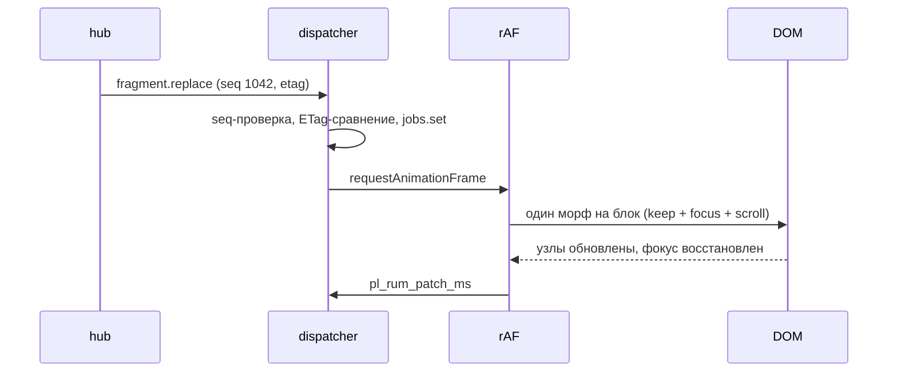
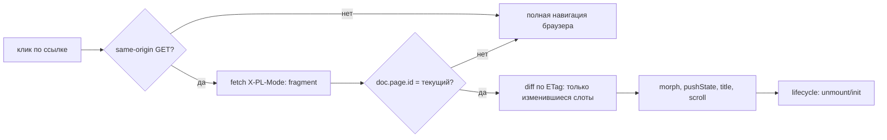

# 04. Клиентский runtime: протокол патчей и гидратация

> Опирается на §9 (события и `seq`), §4 (`Message/Hints`), §8 (коды ошибок), §10 (заголовки, ETag),
> гл. 03 (разметка слотов, `data-pl-*`, `<template data-pl-state>`), гл. 01 (транспорты и кадры).

## 4.1. Цели и бюджет

| Цель | Как проверяем |
|---|---|
| ≤ 15 KB gzip JS | гейт `size-limit` в CI, падение сборки при превышении |
| нет фреймворка, нет сборщика | один ES-модуль + `import()` для тяжёлых сцен (аукцион) |
| прогрессивное улучшение, PWA не нужен | сценарий «JS выключен» в Playwright: навигация и ставка работают |
| INP < 200 мс | RUM `pl_rum_inp_ms` + бюджет 8 мс на кадр применения патчей |

### ADR-04-01: свой runtime вместо фреймворка/htmx

**Решение.** ~14 KB собственных ES-модулей: очередь событий, `morph`, реестр компонентов, транспорт,
формы, RUM. Хук на поведение — делегирование на `document` по `data-pl-*`, а не привязка обработчиков к узлам.

**Почему.** (1) HTML уже отрендерен сервером (гл. 03) и является источником истины: фреймворку пришлось бы
либо гидрировать VDOM поверх нашего HTML (риск mismatch на каждом релизе шаблонов), либо рендерить на клиенте
(теряется SEO и первый экран). (2) §9 задаёт семантику, которой нет в готовых решениях: `seq`-порядок,
`ETag`-идемпотентность, `state.patch`, `signal` без HTML. (3) PRODUCT.md: статический CSS/JS без билд-фреймворка.

**Отвергнуто.** React/Vue/Svelte + SSR — 45–120 KB gzip, гидратация, INP-риски. htmx — правильная идея
(`X-PL-Mode: fragment`), но нет модели `seq/etag` и своего морфа; писать протокол поверх — второй слой.
Alpine — CSP `unsafe-eval` (директивы в атрибутах исполняются как выражения). Web Components на каждый блок —
Shadow DOM ломает морф, стили дублируются, SSR-контент внутри shadow не индексируется.

**Последствия.** Мы владеем morph и его краевыми случаями (§4.3, §4.11) — и обязанностью их тестировать. Плюс —
CSP без `eval`, отсутствие блокировки на мажор фреймворка, детерминированный бюджет веса.

Бюджет по модулям (gzip): `core` (очередь+morph) 5.5, `nav` 2.5, `forms` 1.5, `stream` 3.0,
`auction` 1.5 (ленивый `import`), `rum` 0.7. Итого 14.7 → гейт 15.0.

## 4.2. Протокол событий

Обработчик — единственная точка входа для всего, что приходит из `hub` (§9, таблица типов).

| `Event.Type` | Что делает клиент |
|---|---|
| `fragment.replace` | `jobs.set(id, …)`; один морф на блок за кадр; ETag сравнивается до морфа |
| `state.patch` | RFC 7386 merge в локальный `state`, затем `paintState` по `[data-pl-state]` |
| `signal` | значение в `[data-pl-signal="<id>"]` без HTML и без морфа (таймеры, цена, online) |
| `ack` | `id` = `Idempotency-Key`: снимаем оптимистичное состояние, реконсилируем строку |
| `error` | `backoff` / переподписка; в UI — баннер «обновления с задержкой» (`aria-live="polite"`) |
| `ping` | молча игнорируем (keepalive 15 с) |

- **Порядок.** Строго по `seq` в рамках топика. `seq <= last` → дубль после resume, отбрасываем.
  `seq > last` → применяем: арифметические пропуски номеров законны (номер выдаёт relay, откат транзакции
  оставляет неиспользованный номер, §13.1). Дырка в **доставке** объявляется сервером явно — `error stream.seq_gap`:
  тогда буфер 250 мс и `onGap` → HTTP-догон (`X-PL-Mode: fragment` по затронутым блокам + `Hints.LastSeq`).
  Клиент не додумывает пропуски сам.
- **Батчинг в rAF.** Все события кадра применяются одним колбэком; `jobs` дедуплицирует блоки (побеждает
  последняя версия). Работа на кадр ограничена 8 мс: остаток переносится на следующий кадр, чтобы не сорвать INP.
- **Идемпотентность.** `fragment.replace` с `etag`, равным `data-pl-etag` узла, игнорируется; после морфа
  атрибут обновляется. Это защищает от двойной доставки после reconnect.



## 4.3. Жизненный цикл блока

**Гидратация = привязка поведения, а не пересборка DOM.** Сервер отдал финальный HTML; клиент не создаёт
виртуальное дерево. Единственная точка привязки — делегирование: клики, `submit`, `input` слушаются на
`document` и диспетчеризуются по `data-pl-action`. Поэтому после морфа **ничего не перепривязывается**.

Для изолированных виджетов (таймер аукциона, плеер, чат) есть реестр компонентов и init-блок:

```html
<script type="phytolite/init" data-pl-component="auction-bid">
  {"auction_id":"9f1c","ends_at_ms":1730294400000}
</script>
```

Браузер такое содержимое не исполняет (тип не JS), CSP это не ломает. Runtime читает `textContent` как
**данные** (JSON) и вызывает `components.get("auction-bid").mount(el, props)`, где модуль подгружен
`import()`-ом из нашего origin.

**Почему нельзя eval/innerHTML-скрипты.** Вставленный через `innerHTML` `<script>` не исполняется
(спецификация HTML), а исполнение кода из ответа — это `eval`, запрещённый CSP и превращающий любой
UGC-фрагмент в XSS. Декларативный `type="phytolite/init"` закрывает задачу без исполнения данных.

**Жизненный цикл.** `mount` → (морф затрагивает блок) → `unmount` старого → `mount` нового.
Перед морфом снимаем снимок `[data-pl-component]`; после — у отсоединённых узлов `isConnected === false`,
вызываем их `unmount` (снять таймеры, закрыть `WebSocket`, отписаться от `IntersectionObserver`).
Повторный `mount` того же узла запрещён флагом `data-pl-mounted` — иначе двойные обработчики.

| Атрибут | Смысл |
|---|---|
| `data-pl-fragment` | идентификатор блока = `Fragment.ID` (§5) |
| `data-pl-etag` / `data-pl-v` | идемпотентность и версия контракта |
| `data-pl-keep` | поддерево не морфится (видео, поле ввода чата) |
| `data-pl-state` / `data-pl-signal` | адресация мелкого состояния |
| `data-pl-component` / `phytolite/init` | поведение и его props |
| `data-pl-no-nav` / `data-pl-focus-target` | опт-аут перехвата ссылки / куда вернуть фокус |

## 4.4. Навигация без перезагрузки

Перехват: левый клик без модификаторов, `<a href>`, `GET`, same-origin, без `download/target`, не
`[data-pl-no-nav]`. Запрос уходит с `X-PL-Mode: fragment`, `X-PL-Fragments` (текущие слоты),
`Accept: application/json`; в ответ приходит `ViewDoc` (§5) — включая `<template data-pl-head>` для
`title/meta/canonical`.



- **Смена layout** (`doc.page.id` другой) — полная навигация: другой набор слотов, частичный морф дал бы
  неработающие кнопки. Это осознанная деградация к браузерному поведению, а не «SPA во что бы то ни стало».
- **`pushState`/`popstate`.** В `history.state` кладём `{routeId, scrollY, seqs}`; на `popstate` —
  тот же fetch, скролл восстанавливаем в следующем кадре после морфа. `document.title` и `<html lang>`
  обновляем синхронно с URL.
- **Ошибки.** 5xx/сеть → `location.assign` (полная навигация), 404/410 → серверная страница ошибки
  (коды §8), 429 → не навигируем, показываем `Retry-After`.
- **Prefetch.** hover 70 мс или `IntersectionObserver` с `rootMargin: 200px`, в `requestIdleCallback`,
  кэш `Map` на 10 с и ≤ 20 записей, `AbortController` на навигацию. Отключается при `saveData` или
  `effectiveType` ∈ {slow-2g, 2g}. Prefetch — тот же запрос, что и навигация: без отдельного формата.

## 4.5. Формы и команды

Без JS: `<form method="post" action="/v1/auctions/9f1c/bids">` → сервер отвечает `303` на страницу
(PRG). С JS: `submit` перехватывается, тело уходит JSON-ом, ключ идемпотентности — `crypto.randomUUID()`
на попытку **намерения** (повтор после таймаута переиспользует ключ, новый клик — новый ключ).
CSRF — double-submit `pl_csrf` (§10) в заголовке `X-PL-CSRF` (расширение списка §10, согласовать с гл. 01).

| Ответ | Поведение |
|---|---|
| 200/201 | применить `ViewDoc`/фрагменты из ответа, снять pending |
| 400 `validation.failed` | `errors[].field` → `[data-pl-field]`, `aria-invalid`, фокус на первом |
| 401 `auth.unauthenticated` | редирект на вход с `return=`, форма сохраняется в `sessionStorage` |
| 403 `auth.forbidden` | скрыть действие, объяснить причину |
| 409 `conflict.bid_too_low` | откат pending, стакан из ответа, подсказка «минимум X» |
| 409 `conflict.version` | перезагрузить только блок (`X-PL-Fragments`) |
| 429 `rate.limited` | `Retry-After`: кнопка disabled с обратным отсчётом |
| 5xx / сеть | «не отправлено» + повтор с тем же `Idempotency-Key` (сервер вернёт `idempotency.replay`) |

**Оптимистичные обновления — только для «своей» строки.** Ставка рисуется как `pending`-строка «ваша
ставка 5 000 ₽, отправляется», но **цена и стакан не меняются**: клиент не считает бизнес-значения
(инвариант §3.8). Снятие pending — по `ack` (§9, `id` = ключ) или по ответу команды; откат — удаление
строки, без «прыжка» стакана.

## 4.6. Real-time клиент

### ADR-04-02: SSE по умолчанию, WS в комнате аукциона

**Решение.** Страницы и лента — SSE (`/sse/v1`); комната аукциона и чат — WS (`/ws/v1`), один сокет на
вкладку с мультиплексированием подписок. Оба транспорта питают один и тот же `applyEvent`.

**Почему.** SSE проще: авто-`reconnect`, HTTP/2-friendly, проходит прокси, умирает по `visibilitychange`
без потерь (догон по `since`). WS нужен там, где клиент сам часто пишет: presence/typing в чате, ping/pong
для измерения RTT, 3+ топика на одном сокете — иначе HTTP-лимит соединений и лишние round-trip на каждый чих.
Деньги по WS не ходят (§3.5 инвариант 5) — только подписки и presence.

**Отвергнуто.** Только WS — дороже в эксплуатации (нет авто-reconnect, нужен keepalive, прокси-кеши ломают
upgrade). Только SSE — typing/presence пришлось бы гнать HTTP-командами, съедая rate limit.
Long-polling — только как fallback (§4.6 ниже), не как основа.

**Последствия.** Два транспорта = двойной набор тестов и метрик (`pl_rum_stream_reconnects_total{kind}`).
Клиент обязан уметь деградировать в polling.

- **Тикет.** `EventSource` не умеет заголовки, поэтому `ticket` — в query (`?ticket=…&since=…`); тикет
  одноразовый и короткоживущий (§2), в access-логах маскируется. WS получает тикет так же.
- **Resume.** `since` — максимальный `seq` по топикам. При ручном reconnect конструктор `EventSource`
  создаётся заново, и встроенный `Last-Event-ID` теряется — поэтому `since` всегда в query, а не в заголовке.
- **Backoff.** full jitter: `min(20 c, 500 мс · 2^attempt) · random(0.5…1)`; сброс после первого события.
  Три неудачи подряд → polling (fetch `X-PL-Mode: fragment` + `Hints.LastSeq` раз в 5 с с ростом до 30 с).
  Вернулись на стрим — после первого успешного события.
- **Видимость вкладки.** `hidden` 60 с → закрыть сокет (iOS Safari всё равно убивает `EventSource` в фоне);
  на `visible` — reconnect с `since`. Для комнаты аукциона reconnect немедленный, без ожидания таймера.
- **ping/pong.** Сервер шлёт `ping` каждые 15 с (§9); нет события 45 с → считаем соединение мёртвым.
- **Подписки.** Начальный набор — в query WS; далее `Message{Kind: stream.subscribe}` (§4); `ack` с
  `id` = `Meta.RequestID`, таймаут 3 с → переподписка. Формат кадра — гл. 01.

## 4.7. Аукцион и чат

### ADR-04-03: таймер считается от серверного абсолютного времени

**Решение.** В данных блока есть `ends_at_ms` и `now_ms` (мс UTC). Клиент вычисляет `offset = now_ms − Date.now()`
при каждом обновлении блока/сигнала и на каждом тике пересчитывает остаток как `ends_at_ms − (Date.now() + offset)`.
Счётчик не инкрементируется.

**Почему.** Инкремент `setInterval` плывёт: троттлинг фоновой вкладки (до 1 раза в минуту), сон устройства,
смена системных часов. Абсолютное время + `offset` даёт расхождение < 1 с и не требует доверия к часам клиента.

**Отвергнуто.** Доверять `Date.now()` без offset (часы пользователя врут на минуты). Инкремент (плывёт).
Серверный тик каждую секунду (трафик и `seq`-шум).

**Последствия.** `ends_at` никогда не «досчитывается» локально до нуля: по достижении — «закрывается…», и
победитель объявляется только серверным событием (§3.8: клиент не считает итог аукциона).

**Ставка.** Клик → `pending`-строка → `POST` с `Idempotency-Key` → `ack`/ответ снимает pending →
`conflict.bid_too_low` откатывает строку и обновляет стакан из тела ответа. Кнопка блокируется по
серверному минимуму (`min_amount_text`), не по локальному расчёту.

**Чат.** Порядок — по `seq` топика `chat:room:<id>`; дедупликация по `client_msg_id` (`Map`, TTL 5 мин,
≤ 500 записей): своё сообщение рисуется оптимистично и заменяется серверным при совпадении id. Дырка в `seq` →
буфер 250 мс → догон комнаты. Автоскролл только если пользователь у нижней кромки (< 80 px), иначе кнопка
«новые сообщения». `aria-live="polite"` + `aria-relevant="additions"` на списке; свои сообщения не
объявляются, при > 3 сообщений/с анонсы троттлятся.

## 4.8. RUM

Расширение метрик §10 (префикс `pl_rum_`): `lcp_ms`, `inp_ms`, `cls`, `patch_ms{type}`,
`morph_error_total`, `degraded_share`, `stream_reconnects_total{kind}`, `js_error_total`.

- LCP — `PerformanceObserver("largest-contentful-paint")`, финализация на первом вводе/`hidden`;
  CLS — `layout-shift` с окнами 5 с/1 с; INP — `event` (approximate, без web-vitals, ~40 строк).
- Патчи: время `flush()` (p50/p95), ошибки морфа (исключение → счётчик + `fragment_id`).
- Отправка: батч 30 с / 20 событий / `visibilitychange: hidden` через `navigator.sendBeacon("/v1/rum")`,
  fallback `fetch(…, {keepalive:true})`. Пейлоад ≤ 1 KB: `route_id`, `fragment_id`, `client_id`, метрики.
  Без URL-query и PII. Эндпоинт без аутентификации, rate limit `pl:rl:rum:<cid>` (расширение §10).

## 4.9. Ядро

```js
// web/runtime.js — ядро: очередь событий, morph, стрим. ES2022, без зависимостей (~14 KB gzip на весь рантайм).
const lastSeq = new Map();     // topic → seq
const jobs = new Map();        // fragmentId → job (последняя версия выигрывает)
const hooks = new WeakMap();   // element → { unmount }
let raf = 0;

export function applyEvent(ev, ctx) {
  if (ev.t === "ping") return;
  if (ev.seq && ev.topic) {                             // §9/§13.1: строго по возрастанию
    const last = lastSeq.get(ev.topic) || 0;
    if (ev.seq <= last) return;                         // дубль после resume
    lastSeq.set(ev.topic, ev.seq);                      // арифметические пропуски законны
  }
  if (ev.t === "error" && ev.data && ev.data.code === "stream.seq_gap") {
    return ctx.onGap(ev.topic, lastSeq.get(ev.topic));  // дырку в доставке объявляет только сервер
  }
  if (ev.t === "fragment.replace") {
    const el = document.querySelector('[data-pl-fragment="' + CSS.escape(ev.id) + '"]');
    if (!el || ev.etag === el.dataset.plEtag) return;    // идемпотентность по ETag
    jobs.set(ev.id, { el, html: ev.html, etag: ev.etag, mode: ev.mode || "outer" });
  } else if (ev.t === "state.patch") {
    ctx.state = mergePatch(ctx.state, JSON.parse(ev.data)); paintState(ctx.state);
  } else if (ev.t === "signal") {
    paintSignal(ev.id, JSON.parse(ev.data));
  } else if (ev.t === "ack") {
    ctx.acks.delete(ev.id); ctx.onAck(ev);
  } else if (ev.t === "error") {
    ctx.onStreamError(ev);
  }
  if (!raf) raf = requestAnimationFrame(flush);          // батчинг в кадр
}

function flush() {
  raf = 0;
  const t0 = performance.now();
  for (const j of jobs.values()) morph(j.el, j.html, j.mode, j.etag);
  jobs.clear();
  perf("patch", performance.now() - t0);                 // pl_rum_patch_ms
}

export function morph(root, html, mode, etag) {
  const tpl = document.createElement("template");
  tpl.innerHTML = PL_HTML.createHTML(html);               // Trusted Types: политика 'pl' (§13.11), иначе CSP 01 §8 блокирует морф
  const next = tpl.content.firstElementChild;
  if (!next) return;
  const focus = captureFocus(root);
  const before = [...root.querySelectorAll("[data-pl-component]")];
  if (mode === "inner") syncChildren(root, next); else patchNode(root, next);
  if (etag) root.dataset.plEtag = etag;
  restoreFocus(focus);
  for (const el of before) if (!el.isConnected) hooks.get(el) && hooks.get(el).unmount(el);
  mountTree(root);                                       // init только новых узлов
}

function syncChildren(from, to) {
  const key = (n) => n.dataset.plKey || n.tagName;
  const old = [...from.children].filter((n) => !n.hasAttribute("data-pl-keep"));
  const next = [...to.children];
  next.forEach((nk, i) => {
    const ok = old[i];
    if (!ok || key(ok) !== key(nk)) from.replaceChild(document.importNode(nk, true), ok || null);
    else patchNode(ok, nk);
  });
  old.slice(next.length).forEach((n) => n.remove());
}

function patchNode(a, b) {
  for (const at of [...b.attributes]) if (a.getAttribute(at.name) !== at.value) a.setAttribute(at.name, at.value);
  for (const at of [...a.attributes]) if (!b.hasAttribute(at.name)) a.removeAttribute(at.name);
  if (b.children.length) syncChildren(a, b); else if (a.textContent !== b.textContent) a.textContent = b.textContent;
}

export function connectStream(kind, url, ctx) {
  let tries = 0, timer = 0, sock = null, closed = false;
  const since = () => Math.max(0, ...lastSeq.values());
  const delay = () => Math.min(20000, 500 * 2 ** tries) * (0.5 + Math.random() / 2); // full jitter
  const schedule = () => {
    if (closed) return;
    if (++tries >= 3) kind = "poll";                     // 3 неудачи → polling
    perf("stream_reconnect", 1, { kind });
    timer = setTimeout(kind === "poll" ? () => ctx.poll(since()).finally(schedule) : open,
                       kind === "poll" ? 5000 : delay());
  };
  function open() {
    if (kind === "poll") return schedule();
    if (kind === "sse") {
      // EventSource не умеет заголовки → единственный фолбэк: ticket в query (§13.3)
      sock = new EventSource(url + "?ticket=" + encodeURIComponent(ctx.ticket) + "&since=" + since());
      sock.onmessage = (m) => { tries = 0; applyEvent(JSON.parse(m.data), ctx); };
      sock.onerror = () => { sock.close(); schedule(); }; // backoff свой: встроенный не управляем
    } else {
      // WS: ticket — сабпротоколом, не в query (§13.3)
      sock = new WebSocket(url, ["pl.v1", "pl.ticket." + ctx.ticket]);
      sock.onopen = () => { tries = 0; ctx.subscribeAll(); };
      sock.onmessage = (m) => applyEvent(JSON.parse(m.data), ctx);
      sock.onclose = () => schedule();
    }
  }
  document.addEventListener("visibilitychange", () => {
    if (document.hidden) timer = setTimeout(() => { sock && sock.close(); sock = null; }, 60000);
    else if (!sock) open();
  });
  open();
  return { send: (m) => sock && sock.send(JSON.stringify(m)), close: () => { closed = true; clearTimeout(timer); sock && sock.close(); } };
}
```

## 4.10. Тестирование

**jsdom (unit):** порядок и дедуп `applyEvent`; `seq`-дырка → `onGap`; RFC 7386 (`null` удаляет ключ);
morph сохраняет `[data-pl-keep]`, focus и `selectionStart`; unmount вызывается ровно один раз; merge с
`data-pl-key` не переставляет узлы без нужды.

**Playwright (e2e):** ставка (pending → `ack` → откат при `conflict.bid_too_low`); чат (двойной send —
одно сообщение, дедуп по `client_msg_id`); навигация без перезагрузки
(`performance.getEntriesByType("navigation").length === 1`); навигация с выключенным JS; нулевые CSP-нарушения
(слушаем `console`); skeleton при `degraded`; reconnect (перехват 2 неудач → SSE, 3-я → polling);
фокус после морфа; `prefers-reduced-motion`.

**Гейты CI:** `size-limit` 15 KB; `templ generate` без diff; запрет `eval`/`new Function` линтером;
Lighthouse CI на 3G-профиле (LCP/TBT).

## 4.11. Совместимость и доступность

- **Браузеры:** Chrome/Edge 111+, Firefox 113+, Safari 16.4+. Используем: `fetch`, `AbortController`,
  `EventSource`, `WebSocket`, `WeakMap`, `CSS.escape`, `structuredClone` (опционально).
- **iOS Safari:** `EventSource` закрывается в фоне — штатный reconnect; `100vh` → `dvh`;
  поле ввода чата позиционируем по `visualViewport`; после морфа скролл восстанавливаем в `rAF`
  (иначе momentum-scroll сбрасывается); на `pageshow` с `event.persisted` (bfcache) — reconnect с `since`.
- **`prefers-reduced-motion`:** View Transitions API не используем, если `matchMedia` редукция включена;
  морф всегда без анимации, «переезды» блоков — только CSS-переходы под медиазапросом.
- **Доступность:** чат и цены — `aria-live="polite"` + `role="status"`, без анонса каждого тика таймера;
  после навигации — анонс `document.title` в скрытом `aria-live`; фокус после морфа возвращается на
  `[data-pl-focus-target]` или на заголовок; ошибки формы связаны через `aria-describedby`; скелетоны
  `aria-busy="true"`; интерактив ≥ 44 px по touch-таргетам ставки.

## 4.12. Риски и что сломается первым

1. **Морф и сторонние виджеты.** Плеер трансляции, платёжный iframe, редактор описания ломаются первыми при
   любом релизе разметки. Митигация: `[data-pl-keep]` на контейнере + тест «блок не морфится».
2. **SSE через прокси/антивирус.** Буферизация убивает стриминг: события приходят пачками или не приходят.
   Первый симптом — рост `pl_rum_stream_reconnects_total`; лечится polling-fallback, но UI «живого аукциона»
   становится вялым.
3. **Оптимистичный UI в горячем аукционе.** При гонке ставок поток `conflict.bid_too_low` вызывает мигание
   pending-строк. Митигация: pending только для своей строки, стакан — всегда из серверного HTML.
4. **Рост рантайма.** Каждая фича «ещё чуть-чуть JS» упирается в 15 KB; при превышении гейт падает и фичу
   тащат в ленивый `import`, что бьёт по INP первого клика.
5. **Утечки после многих навигаций.** Накопление `WeakMap`-хуков и таймеров без `unmount` съедает память
   на длинных сессиях; ловится e2e-тестом «20 навигаций → heap не растёт».
6. **bfcache и повторные подписки.** Возврат назад восстанавливает страницу с живыми сокетами и устаревшим
   `lastSeq` → дубли чата. Митигация: генерация соединения + дедуп по `seq`.

## 4.13. Открытые вопросы

1. Один WS на все вкладки через `SharedWorker/BroadcastChannel` — экономим соединения, но усложняем resume
   и отладку; нужно ли для аукционной комнаты?
2. `signal` для таймеров: одно значение на событие или массив сигналов, чтобы не гнать 3 события в секунду?
3. Входит ли RUM-клиент и polling-fallback в бюджет 15 KB или это отдельный (ленивый) чанк?
4. Нужен ли offline-режим (Service Worker) для страницы лота? Кэшировать денежные состояния опасно, нужен
   явный запрет на кэш `ViewDoc` с `state.user.*`.