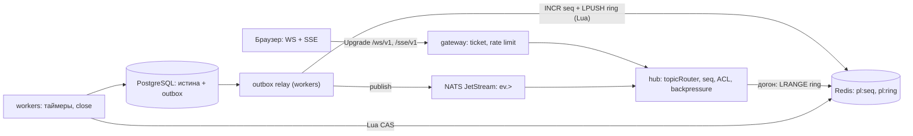

# 05. Real-time: WS/SSE хаб, топики, порядок, backpressure
> Скоуп: `hub` (§1) как отдельный процесс, апгрейд соединений в `gateway`, доставка, `seq`,
> ACL, backpressure, деградация. Типы `Event` и имена топиков — §9, префиксы Redis/NATS и метрики — §10,
> коды ошибок — §8. Всё, чего нет в контракте, помечено **[ext]** и не переиспользует существующие имена.
> Источник истины — PostgreSQL; потоковые события — производная от транзакций и outbox (гл. 06, §6.6).

## 5.1. Зачем оба транспорта
| Транспорт | WS `GET /ws/v1` | SSE `GET /sse/v1` |
|---|---|---|
| Направление | двустороннее | сервер → клиент |
| Что возим | подписки `sub/unsub`, эфемерика (typing), `ack`, `ping` | `fragment.replace`, `signal`, `state.patch`, `ping` |
| Экраны | комната аукциона, мессенджер сделки, стакан | лента `catalog:feed`, уведомления, тикер цены |
| Сеть | требует Upgrade; часть корпоративных TLS-инспекторов рвёт | HTTP/1.1 chunked, проходит везде |
| Реконнект | свой backoff + `since` | автомат `EventSource` + `Last-Event-ID` (§10) |
| Цена | 2 горутины + буферы | 1 горутина, ~40 % меньше памяти |
Оба транспорта — адаптеры над одним `topicRouter`: топики, `seq`, ACL, ring buffer, коалесинг и лимиты живут в одном месте. Различие только в кадрировании.

**ADR-1. Два транспорта, один движок доставки.**
*Решение.* `hub` содержит `sink`-интерфейс (`Send(Event)`, `Close(code,reason)`) и два адаптера `wsConn`/`sseConn`;
вся политика — в роутере, адаптеры не знают про ACL и `seq`.
*Почему.* SSE нужен там, где Upgrade режется прокси/вебвью, и для страниц, которым нечего отправлять
(лента, цена). Один движок — один набор багов; конформанс-тесты гоняются на обоих транспортах.
*Отвергнуто.* (а) только WS — теряем клиентов за жёсткими прокси и SSR-ленту; (б) только SSE — нет
двусторонних `sub/unsub` и чата; (в) long-polling как третий транспорт — дублирует деградационный snapshot (§5.13).
*Последствия.* Лимиты и метрики общие; `pl_ws_connections{transport}` (§10) различает `ws`/`sse`; при
расхождении поведения транспортов виноват адаптер, а не политика.


## 5.2. Хендшейк
1. `POST /v1/realtime/ticket` **[ext]** (cookie `pl_sid` или bearer) → `{ticket, proto:"pl.v1", expires_in:30}`.
   Значение в Redis `pl:tkt:<id>` = `{sub, roles, scopes, cid, sid}`, TTL 30 с, **одноразовый** (`GETDEL`).
2. `GET /ws/v1` с `X-PL-Ticket` (§10). Тикет невалиден → **401 `auth.ticket_invalid`** обычным JSON-ответом,
   без апгрейда: клиент должен увидеть Problem Details (§8), а не закрытие сокета.
3. `Sec-WebSocket-Protocol: pl.v1` обязателен; сервер эхом подтверждает `pl.v1`. Нет заголовка → 400 `validation.failed`.
   `Origin` сверяется с allowlist (за `https://phyto.dev`); `CheckOrigin` на основе `Origin`, не `Host`.
4. Лимиты соединений: **3 на пользователя**, **1 на вкладку** (ключ `(sub, cid)`), **20 на IP на инстанс**.
   Превышение → **429 `rate.limited` + `Retry-After: 5`** до апгрейда; сервер не «ворует» старую вкладку молча.
5. Первый кадр сервера — `hello` **[ext]**: `{"t":"hello","data":{"proto":"pl.v1","session":"…","conn_id":"…",
   "limits":{"queue":256,"frame_in":4096,"event_out":32768,"topics":64,"frames_per_s":20}, "resume":{"supported":true}}}`. Клиент сверяет proto и лимиты; несовпадение → закрытие без реконнекта.
6. Первый `sub` не пришёл за 10 с → закрытие 1000 (клиент открыл сокет и не подписался).
7. Пере-проверка сессии: `hub` лениво перечитывает `pl_sid` раз в 5 мин; истекла → 4001 `auth.ticket_invalid`.

| Код закрытия | Причина | Что делает клиент |
|---|---|---|
| 1000 | норма / нет подписок | не переподключается |
| 1001 | деплой, drain узла (гл. 06, §6.1) | реконнект с `since`, backoff |
| 4001 | тикет/сессия истекли | новый ticket через HTTP, реконнект |
| 4008 | slow consumer, причина содержит `topic=` | реконнект с `since` + snapshot |
| 4009 | **[ext]** >3 соединений на пользователя | не переподключается, закрывает лишнюю вкладку |
```go
func (h *Hub) HandleWS(w http.ResponseWriter, r *http.Request) {
	tk, err := h.tickets.Redeem(r.Context(), r.Header.Get("X-PL-Ticket")) // GETDEL pl:tkt:<id>
	if err != nil {
		problem(w, http.StatusUnauthorized, "auth.ticket_invalid") // §8
		return
	}
	if !h.limits.AllowConn(tk.Subject.ID, tk.ClientID) { // 3 на user, 1 на вкладку
		w.Header().Set("Retry-After", "5")
		problem(w, http.StatusTooManyRequests, "rate.limited")
		return
	}
	c, err := websocket.Accept(w, r, &websocket.AcceptOptions{
		Subprotocols:   []string{"pl.v1"}, // нет proto pl.v1 → 400 validation.failed
		OriginPatterns: h.cfg.OriginPatterns,
	})
	if err != nil {
		return
	}
	c.SetReadLimit(maxFrameIn) // 4 KiB
	h.serve(newConn(c, tk))    // hello → read loop → writer
}
```
## 5.3. Кадры
Кадр — надмножество `Event.Type` (§9): добавляются только `sub`, `unsub`, `pub`, `pong`, `hello` **[ext]**.

| Кадр | Направление | Содержимое | Лимит |
|---|---|---|---|
| `sub` | C→S | `{t:"sub",id:"op1",data:{topics:[{t:"auction:9f1c",since:1041}]}}` | ≤32 топика/кадр, 30 кадров/мин |
| `unsub` | C→S | `{t:"unsub",data:{topics:[…]}}` | — |
| `pub` | C→S | только `chat.typing`, `presence.ping`, `ui.focus` | 10/с на соединение |
| `ack` | S→C | `{t:"ack",id:"op1",data:{topics:[{t:"…",seq:1041}],next_seq:1041}}` | — |
| `err` | S→C | `{t:"error",topic:"…",seq:N,data:{code,title,detail}}` (коды §8 + stream-коды §5.13) | — |
| `ping`/`pong` | оба | пустой `data` | 15 с / timeout 20 с |
Правила.
* `pub` **не является путём записи**. Сообщения чата идут HTTP-командой `POST /v1/chat/rooms/{id}/messages`
  (дедуп по `client_msg_id`, §5.9): так ACL, модерация и `Idempotency-Key` остаются в одном месте, а `hub` не становится вторым писателем домена. `pub` сверх allowlist → `err` `validation.failed`; 5 нарушений за минуту → 4008.
* `err` — тот же формат Problem Details (§8), а не произвольная строка: клиенту нужен `code` для решения.
* Лимит входящего кадра — 4 KiB, исходящего события — 32 KiB. `fragment.replace` больше 32 KiB не отправляется:
  `hub` шлёт `signal` + `err` `stream.too_large`, клиент перезапрашивает блок по HTTP (`X-PL-Mode: fragment`).
* Rate limit кадров — in-memory token bucket на соединение (владелец соединения = инстанс); Redis `pl:rl:*`
  используется только на хендшейке (per user/IP), иначе 100k соединений дают 100k Redis-запросов/с на пустом месте.
* `ping` каждые 15 с на уровне приложения (не только контрольный кадр WS): даёт `seq` живым в SSE и
  позволяет прокси не рвать `idle`-соединения.

## 5.4. Топики и ACL
| Топик | Кто читает | Проверка при подписке | Писатель (единственный) |
|---|---|---|---|
| `auction:<id>` | все, кроме `visibility='hidden'` (только участники/владелец) | `pl:acl:auction:<id>`: `{visibility, owner_id}`, кэш 60 с | bid-транзакция, worker-таймер |
| `chat:room:<id>` | участники комнаты + `moderator` | `chat_rooms.member_ids`, кэш 30 с | chat-ingest (HTTP-команда) |
| `user:<id>` | **только** `auth.subject.id == id` (§9) | сравнение `sub` локально, без Redis | workers (уведомления) |
| `shop:<id>` | витрина публична; `shop:…:orders` — владелец/модератор | `shops.owner_id ∪ subject.shop_ids` | order-writer |
| `catalog:feed` | все | всегда `true` (публичный фид) | feed-worker (инвалидация) |
**ADR-2. ACL проверяется при `sub`, а не при доставке.**
*Решение.* На `sub` роутер вычисляет решение и сохраняет `(topic, acl_version)` в локальной подписке;
дальше `fan-out` не ходит в Redis. Отзыв — отдельное событие `ev.acl.topic.revoke` **[ext]** (§6 NATS: `ev.<domain>.<entity>.<action>`), которое `hub` получает на всех инстансах и точечно снимает подписки.
*Почему.* В комнате на 10k зрителей проверка на каждое событие — 10k Redis-вызовов на один `signal`;
права меняются в масштабе минут, не миллисекунд.
*Отвергнуто.* (а) проверка на каждое событие — см. выше; (б) фильтрация на клиенте — небезопасно (§3.8);
(в) полный пересчёт всех подписок при смене прав — дорого, поэтому отзыв адресный по `topic`/`subject`.
*Последствия.* Окно рассинхрона прав ≤5 с (ленивая пере-проверка) или ≤1 с (адресный `revoke`).
Модерация `chat:room` дополнительно проверяет `status` автора на ингесте; `hub` — только транспорт.

Отзыв прав: `hub` по `revoke` отправляет `err` `auth.forbidden` с `topic` и удаляет подписку; для `user:<id>` при блокировке аккаунта — закрытие 4001. `catalog:feed` и `auction:<id>` публичных лотов не отзываются.

## 5.5. Порядок и `seq`
Инвариант (§12): `seq` в топике строго возрастает. Реализация — **единственный счётчик на топик**: `pl:seq:<topic>` (Redis `INCR`) плюс кольцевой буфер `pl:ring:<topic>`, оба пишутся одной Lua-операцией
**до** публикации в NATS. Публикатор один — `outbox relay` с лизом на топик (гл. 06, §6.6), поэтому
порядок номеров = порядок намерений = порядок `outbox.id` внутри топика.

* Доменные события (ставки, чат, заказы, уведомления) сначала коммитятся в PostgreSQL **с сериализацией
  по строке сущности** (`SELECT … FOR UPDATE` строки аукциона/комнаты), затем попадают в `outbox`. Row-lock гарантирует: для одного топика в полёте не более одной незакоммиченной записи, значит `outbox.id` в топике монотонен по коммитам.
* Эфемерные сигналы (presence, typing, тик таймера) идут тем же путём, но **без** `outbox`: NATS-subject
  `ev.intent.<…>` **[ext]**, коалесинг в relay до 2 событий/с на топик; потеря сигнала не ломает состояние.
* Если relay упал между `INCR` и NATS-публикацией, событие уже лежит в ring. `hub` обнаружит разрыв
  (пришёл `seq` > `last+1`), дотянет пропущенное из ring и только потом доставит текущее.
* Если ring не покрывает разрыв (`maxlen`/TTL), `hub` не «прыгает через дыру», а отправляет `err`
  `stream.seq_gap` и требует snapshot-перезагрузку блока (§5.13). Так инвариант «без дыр в доставленном окне» соблюдается буквально: либо всё по порядку, либо явный сигнал на перезагрузку.
* Арифметическая непрерывность номеров **не** гарантируется: откат транзакции/потеря `intent` оставляет
  неиспользованный номер. Клиент применяет `seq > last`, а не `== last+1` (§5.5, «дедуп на клиенте»).

| Параметр ring | Значение | Обоснование |
|---|---|---|
| `maxlen` | 256 событий | хватает на 60–120 с горячего аукциона и на 50 сообщений чата |
| TTL | 15 мин (`auction`/`catalog:feed`), 60 мин (`chat`) | переподключение после обрыва сети, не «архив» |
| объём | ~256 × 0.5 КБ ≈ 128 КБ/топик | 1000 живых топиков ≈ 130 МБ Redis |
| `since` | `Last-Event-ID` **или** `?since=` (query — только SSE-фолбэк) → `Hints.LastSeq` | контракт §4, §10, §13.3 |
```lua
-- KEYS[1]=pl:seq:<topic>  KEYS[2]=pl:ring:<topic>
-- ARGV[1]=payload JSON (Event без seq)  ARGV[2]=maxlen  ARGV[3]=ttl_ms
-- Атомарно: номер и запись в ring. Публикация в NATS — уже с этим номером.
local seq = redis.call("INCR", KEYS[1])
redis.call("LPUSH", KEYS[2], tostring(seq) .. "|" .. ARGV[1])
redis.call("LTRIM", KEYS[2], 0, tonumber(ARGV[2]) - 1)
redis.call("PEXPIRE", KEYS[2], ARGV[3])
return seq
```
Дедуп на клиенте (гл. 04): `seq <= lastSeq` по топику → событие отбрасывается; `fragment.replace` с равным `ETag` — тоже (идемпотентность HTML). `state.patch` применяется merge-патчем, повтор безопасен.

## 5.6. Fan-out через NATS JetStream
* Stream `EVENTS`, subjects `ev.>`, `limits`-retention (24 ч), `max_msgs` с запасом; producers — только `workers`.
* Каждый инстанс `hub` — **ephemeral push-consumer** с фильтром `ev.>` и `DeliverNew`; `Ack` после
  постановки в локальные очереди соединений. Долгая память не нужна: `seq`/ring в Redis покрывают реконнект.
* Локальный фильтр по топикам: если на инстансе нет подписчиков топика, событие не декодируется в HTML-политику
  и сразу `Ack` — это главная экономия CPU при веерной рассылке на 20 топиков.
* `max_ack_pending` = 1024, `flow_control` включён: при всплеске ставок медленный инстанс не раздувает буфер,
  а замедляет доставку (NATS держит поток, `hub` не падает по памяти).

| Инстанс `hub` | vCPU | RAM | Соединений | Исходящих событий/с | Комментарий |
|---|---|---|---|---|---|
| `hub-s` | 2 | 1.5 GiB | 2 500 | 25 000 | старт, 1 реплика + 1 резерв |
| `hub-m` | 4 | 3 GiB | 10 000 | 100 000 | расчётный целевой (§5.12) |
| `hub-l` | 8 | 6 GiB | 25 000 | 250 000 | только при равномерной нагрузке; упирается в egress |
**ADR-3. JetStream, а не Redis Pub/Sub.**
*Решение.* Транспорт событий — NATS JetStream; Redis — только seq/ring/state.
*Почему.* Нужны replay после рестарта инстанса, `ack` и flow control; Pub/Sub даёт at-most-once и слепнет
на время реконнекта без возможности догона, а догон в Redis пришлось бы реализовывать руками (ring и так есть, но он ограничен 15 мин и горячими топиками).
*Отвергнуто.* (а) Redis Pub/Sub на старте — допустим, **если** ring buffer признан единственным механизмом
догона, а потеря live-события на реконнекте инстанса компенсируется `stream.seq_gap` + snapshot; (б) Kafka — операционно тяжелее для 5–20 топиков/с, JetStream уже в стеке (§1).
*Последствия.* `Ack` после enqueue, не после записи клиенту: смерть инстанса теряет недоставленное,
но клиент восстанавливается по `since` + ring; `pl_stream_seq_lag{topic}` измеряется на `hub`.

```go
func (h *Hub) consumeJetStream(ctx context.Context) error {
	sub, err := h.js.SubscribeSync("ev.>", nats.BindStream("EVENTS"),
		nats.DeliverNew(), nats.ManualAck(), nats.MaxAckPending(1024))
	if err != nil {
		return fmt.Errorf("jetstream subscribe: %w", err)
	}
	for {
		m, err := sub.NextMsg(ctx)
		if err != nil {
			return err // ctx.Done / разрыв: пересоздаём consumer
		}
		ev, topic, err := decodeEvent(m.Data) // §9 Event + topic из headers
		if err != nil {
			_ = m.Term()
			continue
		}
		if h.router.HasLocal(topic) { // подписчики есть — decode + fan-out
			h.router.Deliver(topic, ev) // gap-repair через ring + fan-out
		}
		_ = m.Ack()
	}
}
```

## 5.7. Горячее состояние аукциона
Ключ `pl:auction:<id>:state` (§10), поля: `current_price, leader_id, ends_at, version, last_bid_id, bids_count, status`. Это **кэш для чтения и быстрого отказа**, истина — `auctions` в PostgreSQL. Запись — `Lua CAS` по `version`; расхождение версий означает «кто-то записал новее», кэш перечитывается из БД, а не перезаписывается вслепую.

Порядок записи в ставке: (1) `UPDATE auctions … WHERE current_price + min_step <= $amount AND ends_at > now()` в транзакции вместе с `bids`, холдом баланса и `outbox`; (2) после `commit` — `Lua CAS` в Redis; (3) `relay` публикует событие. Если шаг 2 упал, кэш отстанет на один тик — worker сверки (§5.7, sweep) исправит и опубликует `state.patch` с фактическим состоянием.

Таймеры: `ZADD pl:auction:deadline` **[ext]** `score=ends_at`; worker опрашивает `ZRANGEBYSCORE … LIMIT 100` каждые 100 мс (p95 задержка закрытия ≤150 мс), плюс страховочный `sweep` `SELECT … WHERE status='active' AND ends_at < now()` раз в 10 с — на случай потери ZSET. Закрытие лота — обычная транзакция: `status='finished'`, заказ, outbox-событие `auction.closed`.
*Почему не Redis expiry как таймер:* `PEXPIRE` на `pl:auction:<id>:state` управляет только TTL кэша; keyspace notifications теряются при `maxmemory-policy` и отстают под нагрузкой — закрывает worker по ZSET, а БД подтверждает.

Антиснайпинг: ставка в последние 60 с → `ends_at = ends_at + 60s` в той же транзакции, не более 10 продлений (итоговое окно ≤10 мин). Правило живёт в одном месте — `WHERE` транзакции ставки, не в таймере и тем более не в JS (иначе клиент «считает бизнес-значения», §3.8).

```lua
-- KEYS[1]=pl:auction:<id>:state
-- ARGV: bid_id, amount, leader_id, ends_at_unix, version, ttl_ms
local cur = tonumber(redis.call("HGET", KEYS[1], "version") or "0")
if cur > tonumber(ARGV[5]) then return 0 end        -- в кэше уже новее: не откатываем
redis.call("HSET", KEYS[1],
  "current_price", ARGV[2], "leader", ARGV[3], "ends_at", ARGV[4],
  "version", ARGV[5], "last_bid_id", ARGV[1])
redis.call("PEXPIRE", KEYS[1], ARGV[6])
return 1
```

```sql
-- страховка: live-лоты, по которым кэш мог отстать
SELECT a.id, a.current_price, a.leader_id, extract(epoch FROM a.ends_at)::bigint AS ends_at, a.version
FROM auctions a
WHERE a.status = 'active' AND a.ends_at > now() - interval '10 minutes'
ORDER BY a.ends_at
LIMIT 500;
CREATE INDEX auctions_active_ends_idx ON auctions (ends_at) WHERE status = 'active';
```

## 5.8. Ставка: HTTP-команда → топик
```mermaid
sequenceDiagram
  autonumber
  participant B as Клиент
  participant G as gateway
  participant P as PostgreSQL
  participant R as outbox relay
  participant N as NATS
  participant H as hub
  B->>G: POST /v1/auctions/{id}/bids + Idempotency-Key
  G->>P: BEGIN; row-lock auction; guard: цена+шаг, не свой лот, холд баланса
  P-->>G: bid_id, seq не нужен (назначит relay)
  G-->>B: 201 {bid_id, current_price, ends_at} + outbox в той же TX
  R->>P: outbox WHERE published_at IS NULL ORDER BY id
  R->>H: Lua: INCR pl:seq + LPUSH ring
  R->>N: ev.auction.<id>.bid (payload §9)
  N->>H: fan-out всем инстансам
  H-->>B: signal (цена, лидер, таймер) → затем fragment.replace стакана
  H-->>B: (опоздавшему) 409 conflict.bid_too_low → snapshot
```

* **Ставка по WS запрещена** (§3.5). Причины: `Idempotency-Key` и повтор запроса как норма HTTP-семантики;
  видимый код ошибки (§8) вместо `err`-кадра без тела; транзакция + `outbox` живут в одном процессе с `sqlc`; `hub` остаётся stateless-доставкой и не становится денежным писателем.
* `ack` по WS — это подтверждение подписки/приёма кадра, **не** подтверждение ставки. Ставку подтверждает
  HTTP-ответ; `signal` из топика лишь отображает серверное значение.

| Шаг | p95 | Как держим |
|---|---|---|
| gateway: auth, rate limit, валидация | 8 мс | ноль сетевых вызовов кроме Redis (сессия, `pl:rl`) |
| PostgreSQL: row-lock + guard + outbox | 25 мс | один `UPDATE` по PK, `synchronous_commit=on`, индекс `bids(auction_id, created_at desc)` |
| ответ клиенту (коммит) | 5 мс | ответ до публикации события; `seq` не нужен |
| relay: `outbox` → `INCR`+ring → NATS | 15 мс | `LISTEN/NOTIFY` `outbox` + поллинг 20 мс как страховка |
| NATS → `hub` → локальные соединения | 10 мс | `MaxAckPending`, нет внешних вызовов в `fan-out` |
| сеть клиента + paint | 30 мс | `signal` ≤120 B, без рендера |

Итого «клик → чужой экран» ≈ 90–110 мс p95 при бюджете 150 мс. Рендер `fragment.replace` (стакан) вынесен
**после** `signal` и не входит в бюджет команды: цена обновляется мгновенно, HTML стакана — следующим `seq`.

## 5.9. Чат
* Запись — только `POST /v1/chat/rooms/{id}/messages` с `client_msg_id` (UUID клиента) и `Idempotency-Key`.
  `hub` в `chat:room:<id>` только доставляет. Ответ — код 201 + `seq` ещё неизвестен: `ack` придёт событием, клиент держит сообщение в `pending` и снимает по `msg_id` (дедуп по `client_msg_id` — ниже).
* Дедуп: `chat_dedup` (`PRIMARY KEY (room_id, client_msg_id)`, ретеншн 7 дней). Повтор возвращает тот же `msg_id`.
* История: партиционирование по месяцам; при подписке клиент получает последние 50 из ring, если тот холодный —
  `fragment.replace` блока `chat.messages` через HTTP (гл. 03). Храним `created_at`, а не `seq`: порядок в комнате задаёт `created_at + msg_id`, `seq` принадлежит топику и живёт только в транспорте.
* Rate limit: 5 сообщений / 10 с и 60 / мин на пользователя, 200 / мин на комнату (`pl:rl:chat:<uid>`, §10).
* Модерация: wordlist-фильтр на ингесте (нормализация + стемминг, без внешнего вызова в hot path);
  жалоба → `chat_moderation`, `moderator` скрывает сообщение. Скрытие — `tombstone`-событие: `fragment.replace` с `data:{msg_id, status:"deleted"}`, HTML пустой; из БД сообщение не удаляется.
* `fragment.replace` для `Mode:"append"` (§9) — только новые сообщения, чтобы не перерисовывать ленту.

```sql
CREATE TABLE chat_messages (
  room_id    uuid NOT NULL,
  msg_id     uuid NOT NULL,
  author_id  uuid NOT NULL,
  body       text NOT NULL CHECK (char_length(body) BETWEEN 1 AND 2000),
  status     text NOT NULL DEFAULT 'visible'
             CHECK (status IN ('visible','deleted','hidden')),
  created_at timestamptz NOT NULL DEFAULT now(),
  PRIMARY KEY (room_id, created_at, msg_id)
) PARTITION BY RANGE (created_at);
CREATE TABLE chat_messages_2026_11 PARTITION OF chat_messages
  FOR VALUES FROM ('2026-11-01') TO ('2026-12-01');
CREATE INDEX ON chat_messages (room_id, created_at DESC);   -- последние 50
CREATE TABLE chat_dedup (
  room_id       uuid NOT NULL,
  client_msg_id uuid NOT NULL,
  msg_id        uuid NOT NULL,
  created_at    timestamptz NOT NULL DEFAULT now(),
  PRIMARY KEY (room_id, client_msg_id)
);
-- ретеншн: DELETE FROM chat_dedup WHERE created_at < now() - interval '7 days';
```

## 5.10. Presence и «N смотрят»
`pl:presence:<topic>` — **ZSET**, `score = now + 30s`, `member = conn_id` (SET с TTL на элемент невозможен; имя ключа — из §10, тип значения уточнён). Heartbeat `ZADD` раз в 15 с; sweep `ZREMRANGEBYSCORE` раз в 5 с; `ZCARD` = «N смотрят».

| Что | Частота | На 10k зрителей в одной комнате |
|---|---|---|
| heartbeat | 1 / 15 с на соединение | 667 `ZADD`/с — 0.7 % CPU Redis |
| sweep | 1 / 5 с | 0.2 оп/с |
| вещание `signal online` | коалесинг 1 Гц | 10k × 90 B = 0.9 МБ/с на инстанс-веер |
| порог тишины | >2k зрителей: вещание раз в 5 с, без join/leave поимённо | 2k × 90 B = 0.2 МБ/с |
| отключение | `PL_PRESENCE_ENABLED=false` / флаг `pl:flag:presence` | `signal` `{online:null}`, блок скрывается |

Presence-дельта **не** уходит в `outbox` и не гарантируется: рассинхрон при потере дельты лечится `ZCARD` на следующем тике. Персональные `join/leave` не вещаем — на 10k это 10k событий на каждое подключение.

## 5.11. Backpressure
Очередь на соединение — кольцевой буфер **256 слотов** и жёсткий лимит **512 KiB** на соединение;
байты считаются в `enqueue`/`dequeue` (не только слоты), при превышении — коалесинг, затем `4008`.

| Тип | Политика при заполнении | Что теряем |
|---|---|---|
| `signal` | заменяет предыдущий `signal` с тем же `id` (полное значение, last-wins) | промежуточные тики — безопасно |
| `state.patch` | мёржится с ещё не отправленным патчем (последнее значение по ключу) | безопасно |
| `fragment.replace` | последний по `id` вытесняет непоказанный | промежуточный HTML не нужен |
| `ack`/`error` | не вытесняются, FIFO; не влезли → закрытие 4008 | разрыв контракта операции — закрываем |

Слоу-консьюмер: при `queue=256` (или `>100` вытесненных за 10 с) — `pl_ws_slow_consumer_total{transport}`, закрытие **4008** с причиной `"slow-consumer topic=auction:9f1c queue=256 dropped=173"`: клиент знает, какой топик перегружен, и делает snapshot именно его. `socket buffer` (`SetWriteDeadline` 10 с) — второй рубеж.

Защита памяти: `GOMEMLIMIT` = 75 % лимита контейнера, мягкий лимит `hub` (80 % `GOMEMLIMIT`) запускает эвикцию самых медленных 1 % соединений (4008) вместо OOM-kill всего инстанса.

```go
// enqueue — единственный вход событий в соединение; вызывает shard роутера.
func (c *conn) enqueue(ev view.Event) {
	c.mu.Lock()
	defer c.mu.Unlock()
	if c.closed {
		return
	}
	key := ev.Type + "|" + ev.ID // коалесинг: signal и fragment.replace — по одному id
	if _, ok := c.pending[key]; ok {
		c.pending[key] = ev // последний побеждает, позиция в очереди сохраняется
		return
	}
	if len(c.keys) >= c.limits.Queue { // 256
		c.slowEvicted++
		return
	}
	c.pending[key], c.keys = ev, append(c.keys, key)
	c.cond.Signal()
}

func (c *conn) writeLoop(ctx context.Context) { // одна горутина на соединение
	for {
		key, ok := c.pop(ctx) // блокируется на cond, уважает ctx.Done
		if !ok {
			return
		}
		if err := c.writeJSON(ctx, c.take(key)); err != nil {
			c.closeWith(4008, "slow-consumer topic="+c.lastTopic)
			return
		}
	}
}
```

## 5.12. Ёмкость `hub` (расчёт на 10k соединений/инстанс)
| Ресурс | На соединение | 10 000 соединений | Допущение |
|---|---|---|---|
| горутины | 2 (reader + writer) + 1/256 на shard | ~20 040 | reader блокирован на `ReadMessage` |
| память | rbuf 4 KiB + wbuf 4 KiB + очередь | ~180–260 MiB | средняя очередь 2–4 события по 400 B; пик 512 KiB × редкие |
| FD | 1 | 10 000 + ~150 | `ulimit -n 65536`, `nf_conntrack_max` ≥ 131072 |
| epoll | Go netpoller, 1 поток на `GOMAXPROCS` | — | нет горутины на `accept`-цикл |
| GC | `GOGC=100`, `GOMEMLIMIT=2.2GiB` | паузы 1–3 мс | единый арена-подход: события аллоцируются в `sync.Pool` |
| egress | 10 событий/с × 200 B | 20 МБ/с ≈ 160 Мбит/с | `signal` вместо HTML; фрагменты коалесятся до 1/с |

Практический предел инстанса `hub-m` — **10k** соединений при 10 событиях/с; при 50 событиях/с (чат-шторм) предел падает до ~4k, и масштабирование идёт горизонтально: соединения распределяются LB, `fan-out` уже per-instance, шардирование по комнате не нужно.

## 5.13. Деградация
| Триггер | Действие | Что видит клиент |
|---|---|---|
| NATS недоступен >5 с | `hub` держит соединения, шлёт `ping`; `seq` не растёт | `ping` без событий → клиент через 30 с уходит в polling |
| Redis недоступен | `resume:false` в `hello`, live-доставка без догона | после реконнекта — snapshot, затем live |
| `pl_stream_seq_lag > 5s` | топик помечается `degraded`, `err` `stream.degraded` | блок перезапрашивается по HTTP c backoff |
| `hub` перегружен / деплой | `gateway` отвечает на `/ws/v1` **503 + `Retry-After: 10`** | polling `GET /v1/auctions/{id}/snapshot?since=seq` **[ext]** |
| `PL_WS_ENABLED=false` (kill-switch) | только SSE для разрешённых топиков + polling | страница работает, чат — только чтение |
| presence отключён | `signal {online:null}` | «N смотрят» скрыт |

Stream-коды **[ext]** — расширение §8 только новыми кодами: `stream.seq_gap`, `stream.degraded`, `stream.too_large`, `stream.acl_revoked`, `stream.epoch_reset`; все доставляются кадром `err` и содержат `topic`.
Snapshot-эндпоинт: `GET /v1/auctions/{id}/snapshot?since=seq` → `ViewDoc` (гл. 02) с `fragments` + `Meta.NextSeq` (§5); клиент применяет фрагменты и подписывается с `since=next_seq` — между snapshot и `sub` события не теряются.

```go
func (h *Hub) HandleSSE(w http.ResponseWriter, r *http.Request) {
	// EventSource не умеет заголовки: тикет допускается в ?ticket= (одноразовый, 30 с)
	tk, err := h.tickets.Redeem(r.Context(), ticketOf(r))
	if err != nil {
		problem(w, http.StatusUnauthorized, "auth.ticket_invalid")
		return
	}
	topics := parseTopics(r.URL.Query()["topic"])
	sub, err := h.router.Subscribe(r.Context(), tk, topics, lastEventID(r)) // §10 Last-Event-ID
	if err != nil {
		problem(w, http.StatusForbidden, "auth.forbidden")
		return
	}
	defer sub.Close()
	w.Header().Set("Content-Type", "text/event-stream")
	w.Header().Set("Cache-Control", "no-store")
	w.Header().Set("X-Accel-Buffering", "no") // nginx не буферизует поток
	fl, _ := w.(http.Flusher)
	for ev := range sub.C {
		fmt.Fprintf(w, "id: %s:%d\nevent: %s\ndata: %s\nretry: 3000\n\n", ev.Topic, ev.Seq, ev.Type, ev.Data)
		fl.Flush()
	}
}
```

## 5.14. Риски и что сломается первым
1. **Единственный счётчик `pl:seq` на топик.** Потеря Redis (failover без AOF `everysec`) откатывает `seq`
   назад: `hub` увидит `ev.Seq <= last` и обязан трактовать это как смену эпохи, а не как дубль. Без явной `epoch`-проверки клиенты молча «залипнут» на старом `seq`. Первым сломается resume после failover.
2. **Relay как SPOF порядка.** Пока лиза на топик не переехала (3–5 с), события копятся в `outbox`; при
   двух relay с просроченным лизом возможна перестановка `seq` в топике. Нужен `fencing token` (§6.6), иначе `conflict.bid_too_low` будет приходить на уже перебитую ставку.
3. **Коалесинг против корректности стакана.** Замена `fragment.replace` «последним» может потерять удаление
   строки (tombstone приходит раньше append). Лечится запретом коалесинга для `chat.messages` и явным `Mode:"replace"` с `seq` больше последнего.
4. **10k в одной комнате.** Один `signal` = 10k кадров; при 10 Гц это 100k кадров/с на инстанс и упор в
   `syscall`-профиль. Первым деградирует не `hub`, а `egress` и клиентский `main thread`.
5. **ACL-кэш 60 с.** Скрытие лота или бан пользователя видны с задержкой; жалобы «чужой лот в списке»
   приходят раньше, чем `revoke` доезжает до всех инстансов.
6. **Ring buffer вытесняет историю чата.** 15-минутный TTL auction-топика и `maxlen 256` не покрывают
   «прокрутил вверх»: запрос истории обязан идти в БД, иначе в UI появляются дыры.

## 5.15. Открытые вопросы
1. Нужен ли `epoch` в `Event` (поле `e`) для формальной инвалидации `seq` после failover Redis, или достаточно
   `err` `stream.seq_gap` + snapshot? Сейчас контракт поля не имеет, а без него откат `seq` неотличим от дубля.
2. Сколько соединений на пользователя — 3 (UX вкладок) или 1 с мультиплексированием всех топиков страницы?
   Второе дешевле по FD и presence, но требует `SharedWorker`, а он ненадёжен в Safari.
3. Допустим ли `pub` для `chat.message` в v2 (экономия RTT ~15 мс), если модерация и `client_msg_id`
   останутся на инггесте? Сейчас сознательно запрещено ради единственного писателя.
4. Отдавать ли historical backlog `catalog:feed` из ring (100 последних) или только live + полный рендер ленты?
