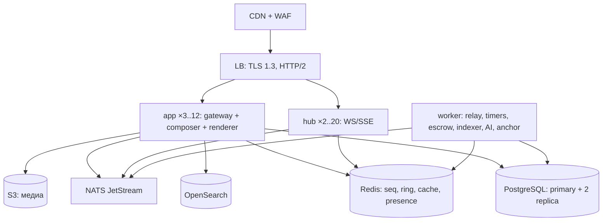

# 06. Эксплуатация: надёжность, наблюдаемость, безопасность, ёмкость

> Глава описывает, как набор из §1 живёт в проде: топология, конфиг, телеметрия, SLO, отказы, данные, безопасность,
> стоимость и runbook. Денежные гарантии опираются на §3.5 (только HTTP-команда + транзакция + outbox); потоковые
> события — на гл. 05. Новые имена помечены **[ext]**.

## 6.1. Топология развёртывания

Три бинарника (§1): `app` (gateway + composer + renderer в одном процессе), `hub`, `worker`. Разделение `renderer` —
вопрос масштабирования, а не дизайна (границы — §7).

| Компонент | Бинарник | Реплики prod | Масштабирование | Состояние |
|---|---|---|---|---|
| gateway+composer+renderer | `app` | 3–12 | HPA по CPU 65 % и RPS; readiness зависит от PG/Redis | stateless, кэш в Redis |
| real-time хаб | `hub` | 2–20 | HPA по `pl_ws_connections{transport}`; PDB `maxUnavailable: 1` | соединения в памяти |
| воркеры | `worker` | по типу: relay 2, таймеры 2, escrow 1, индексатор 1, AI 1, anchor 1 | очередь/лаг; singleton'ы через лиз | stateful через БД |
| PostgreSQL 16 | managed | primary + 2 replica | вертикально + партиции | истина |
| Redis 7 | managed | 3 (sentinel) | по памяти | кэш, `seq`, ring, presence |
| NATS JetStream | managed/self | 3 (R3) | по throughput | события |
| S3/MinIO, OpenSearch | managed | — | — | медиа, поиск |

Правила размещения: `app` и `hub` — анти-аффинность по зонам (`topologySpreadConstraints`, `maxSkew: 1`);
`hub` не смешивается с `app` на одной ноде (egress и GC `hub` шумят); `worker`-relay — анти-аффинность между
репликами (лизы не должны жить на одной ноде).

**Rolling deploy.** `app`: `maxSurge: 1, maxUnavailable: 0`, `startupProbe` 30×1 с, `readinessProbe` каждые 5 с
(проверяет `SELECT 1` с дедлайном 200 мс и `PING` Redis). `livenessProbe` проверяет **только процесс**
(`/livez` → 200, если планировщик горутин жив), иначе падение PG вызывает лавину рестартов.
`hub`: `maxUnavailable: 1`, `preStop` `sleep 5` (LB успевает снять endpoint), затем drain (ниже). Порядок релиза:
**goose-миграции (отдельный Job) → `app` → `worker` → `hub`**; миграции только expand-contract, совместимые с N−1.



Graceful shutdown `hub` — единственное место, где важна не «процедура», а то, что клиент **не** теряет `seq`:

```go
func (h *Hub) Shutdown(ctx context.Context) error {
	h.ready.Store(false)              // /readyz → 503, LB снимает endpoint
	_ = h.listener.Close()            // новые апгрейды → 503 + Retry-After (gateway)
	h.broadcastClose(websocket.StatusGoingAway, "drain") // 1001: клиент идёт на другую реплику
	tick := time.NewTicker(200 * time.Millisecond)
	defer tick.Stop()
	deadline := time.After(h.cfg.DrainTimeout) // 30 s
	for h.conns.Load() > 0 {
		select {
		case <-deadline:
			h.forceClose(websocket.StatusGoingAway, "drain-timeout")
			return nil
		case <-tick.C:
		}
	}
	return nil
}
```

## 6.2. Конфигурация и секреты

Источники: env (12-factor) > файл `/etc/pl/config.yaml` > дефолты. Секреты — **только** из секрет-стора
(Vault agent inject → env/файл), никогда из ConfigMap/репозитория. Валидация — на старте, одним `errors.Join`,
с падением процесса: сервис, поднявшийся с `sslmode=disable` в prod, опаснее упавшего.

| Секрет | Где живёт | Ротация |
|---|---|---|
| `PL_DB_DSN`, `PL_REDIS_URL` | Vault `kv/pl/prod` | 90 дней, двойной пароль PG |
| ticket — opaque id в Redis (`pl:tkt:<id>`, `GETDEL`, TTL 30 с, 01 §3.3); Ed25519 для ticket не используется (только для подписи событий/вебхуков) | — | бесшовно: ticket одноразовый и живёт 30 с |
| `PL_NATS_CREDS` | Vault | 90 дней |
| ключи внешних API (LLM, blockchain) | Vault | по требованию провайдера |
| `PL_INTERNAL_HMAC_KEY` (подпись событий/вебхуков, §6.8) | Vault | 180 дней, `X-PL-Key-Id` (§10) |

Ключ подписи тикета: `kid` уходит клиенту в `X-PL-Key-Id`; `hub` и `gateway` держат `map[kid]publicKey`,
старый `kid` принимается 24 ч после ротации. Приватный ключ в процессе, который выдаёт тикеты, — не в `hub`.

**Секреты в логах.** `slog`-хендлер с `ReplaceAttr`: значения ключей, матчащих `(?i)secret|token|password|dsn|authorization|ticket|cookie`,
заменяются на `"[redacted]"`; тело `Message.Body` и `Authorization` не логируются никогда. Идентификатор
пользователя — `user_hash = sha256(user_id || pepper)[:12]`, pepper — секрет; по логам нельзя восстановить `user_id`,
но можно связать сессию.

```go
type Config struct {
	Env       string   `env:"PL_ENV"`            // dev|stage|prod
	DBDSN     string   `env:"PL_DB_DSN"`
	TicketKeys []Key   `env:"PL_TICKET_KEYS"`    // kid → ed25519 public
	HubURL    string   `env:"PL_HUB_URL"`
	WSEnabled bool     `env:"PL_WS_ENABLED"`     // kill-switch (гл. 05, §5.13)
	LogLevel  string   `env:"PL_LOG_LEVEL"`
}

func (c *Config) Validate() error {
	var errs []error
	if c.Env == "prod" && strings.Contains(c.DBDSN, "sslmode=disable") {
		errs = append(errs, errors.New("PL_DB_DSN: sslmode=disable запрещён в prod"))
	}
	if len(c.TicketKeys) == 0 {
		errs = append(errs, errors.New("PL_TICKET_KEYS: пусто"))
	}
	if c.Env == "" || c.LogLevel == "" {
		errs = append(errs, errors.New("PL_ENV/PL_LOG_LEVEL: обязательны"))
	}
	return errors.Join(errs...) // старт падает со списком всех проблем, а не с первой
}
```

## 6.3. Наблюдаемость

Трассировка — OpenTelemetry, propagator W3C `traceparent` (`Meta.TraceID`, §4). Один trace на `Message`, спан на
каждый шаг маршрута и каждый блок; `hub` продолжает trace команды, создавшей событие, — по `trace_id` в payload.

| Span | Родитель | Атрибуты | Где |
|---|---|---|---|
| `http.server` | — | `http.route, pl.route.id, pl.route.version, pl.transport` | gateway |
| `route.execute` | `http.server` | `pl.route.id, pl.route.budget_ms, pl.cache` | composer |
| `route.step` | `route.execute` | `pl.step, pl.step.kind, pl.step.optional, pl.cache` | composer |
| `fragment.render` | `route.execute` | `pl.fragment, pl.fragment.v, pl.fragment.bytes` | renderer |
| `command.bid` | `http.server` | `pl.auction.id, pl.idempotency.hit` | gateway/DB |
| `hub.publish` / `hub.fanout` | `command.bid` (link) | `pl.topic, pl.seq, pl.conns` | hub, relay |

Метрики — §10 без переименований; расширение только новыми: `pl_ws_slow_consumer_total{transport}`,
`pl_hub_queue_depth{shard}`, `pl_relay_lease_owner_total{topic}`, `pl_dependency_circuit_state{dep}` **[ext]**.
Histogram'ы `pl_http_request_duration_seconds` и `pl_bid_command_duration_seconds` включены с exemplars: из
графика SLO можно прыгнуть в конкретный trace.

Логи — `slog` JSON, обязательные поля: `ts, level, msg, service, request_id, trace_id, span_id, user_hash, route, status, dur_ms, cache, degraded`. Уровни: `error` — только 5xx/деградации, требующие действия; `warn` —
деградированные фрагменты, сработавшие предохранители; `info` — доступ и команды (без тел).

| Дашборд | Панели |
|---|---|
| RED по маршрутам | rate/errors/duration p50/p95/p99 по `route` и `status`; `pl_fragment_degraded_total` |
| USE по инфраструктуре | PG: connections, WAL, bloat, slow queries; Redis: ops/с, memory, evicted; NATS: lag, consumer pending |
| Real-time | `pl_ws_connections{transport}`, `pl_stream_seq_lag{topic}`, slow consumers, queue depth |
| Деньги | `pl_bid_command_duration_seconds`, ставок/мин, `pl_outbox_lag_seconds`, расхождения сверки |
| Ёмкость | RPS/CPU/память по сервисам, egress `hub`, рост БД |

Алерты — по SLO, не по причинам: многоканальный burn-rate (1 ч / 5 мин) на бюджеты из §6.4, плюс
симптомные триггеры (`pl_stream_seq_lag > 5s` 5 мин, `pl_outbox_lag_seconds > 60`, `hub` memory > 85 %
`GOMEMLIMIT`, ошибки 5xx > 1 % за 5 мин). Алерт без runbook (§6.10) не заводится.

```go
func (e *executor) runStep(ctx context.Context, s manifest.Step, doc *view.ViewDoc) error {
	ctx, span := e.tracer.Start(ctx, "route.step",
		trace.WithAttributes(
			attribute.String("pl.route", doc.Route.ID),
			attribute.String("pl.step", s.ID),
			attribute.String("pl.step.kind", string(s.Kind)),
			attribute.Bool("pl.step.optional", s.Optional)))
	defer span.End()
	if err := e.exec(ctx, s, doc); err != nil {
		span.RecordError(err)
		span.SetStatus(codes.Error, s.ID)
		if s.Optional {
			return nil // fragment.degraded, страница отдаётся (§8)
		}
		return err
	}
	return nil
}
```

## 6.4. SLO и бюджеты ошибок

| SLO | Цель (30 дней) | SLI | Бюджет | Реакция при выгорании |
|---|---|---|---|---|
| Доступность | 99,9 % | доля запросов без 5xx/таймаутов | 43 мин | 2 %/1 ч → page; 5 %/6 ч → тикет; 100 % → стоп релизов |
| HTML p95 | 300 мс аноним / 500 мс персонализированный | `pl_http_request_duration_seconds` по `route` | 5 % запросов медленнее | профилирование, срез тяжёлых маршрутов |
| Ставка p95 | 150 мс | `pl_bid_command_duration_seconds` | 5 % | проверка пула PG, relay lag, блокировок |
| Лаг событий p95 | < 500 мс | `now − event.created_at` на `hub` | 5 % | см. runbook «лаг растёт» |
| Доля degraded | < 0,5 % ответов | `X-PL-Degraded` / `pl_fragment_degraded_total` | 0,5 % | разбор отказавших шагов |

Политика бюджета: при исчерпании — заморозка фич (только исправления и деградации), постмортем обязателен
для инцидентов > 15 мин или любого расхождения денег; у каждого инцидента — action item с владельцем и сроком.
Бюджет считается по каждому SLI отдельно; «доступность в норме» не оправдывает рост degraded.

## 6.5. Нагрузочное тестирование

| Сценарий | Профиль | Что проверяем | Критерий приёмки |
|---|---|---|---|
| Лента | 2 000 RPS, 10 мин | кэш CDN/renderer, PG на тяжёлом маршруте | p95 < 300 мс, 5xx < 0,1 % |
| Карточка товара | 1 000 RPS, персонализированная 20 % | `composer` DAG, `route.step` p95 | p95 < 500 мс, degraded < 0,5 % |
| Комната аукциона | 10 000 WS + 50 ставок/с, 10 мин | `hub`: память, egress, коалесинг; PG row-lock | ставка p95 < 150 мс, память `hub` без роста, 0 `seq`-разрывов |
| Чат-шторм | 100 сообщений/с в 20 комнатах | ингест, партиции, rate limit | p95 ингеста < 80 мс, нет очереди на запись |
| Soak | 1 000 RPS + 2 000 WS, 2 ч | утечки, GC, `outbox`, `pl_stream_seq_lag` | RSS стабилен ±5 %, лаг p95 < 500 мс |

Профилирование: `net/http/pprof` на внутреннем `:6060` (не публикуется), снятие CPU при рампе, heap после
30 мин, `block`/`mutex` под чат-штормом. Каждый PR — смоук 1 000 RPS / 5 мин в CI; полный прогон — ночью
на stage с прод-объёмом данных (иначе `outbox` и индексы ведут себя иначе). Результаты — артефакт с
коммитом и версией конфигурации; регресс p95 > 15 % блокирует релиз.

```js
export const options = {
  scenarios: {
    feed:    { executor: "constant-arrival-rate", rate: 2000, timeUnit: "1s",
               duration: "10m", preAllocatedVUs: 300, maxVUs: 900 },
    auction: { executor: "ramping-vus", startVUs: 0,
               stages: [{ target: 10000, duration: "5m" }] }, // WS-соединения
    bids:    { executor: "constant-arrival-rate", rate: 50, timeUnit: "1s",
               duration: "10m", preAllocatedVUs: 50 },
  },
  thresholds: {
    http_req_duration: ["p(95)<300", "p(99)<900"],
    "http_req_duration{route:bid_command}": ["p(95)<150"],
    pl_stream_seq_lag_ms: ["p(95)<500"],
  },
};
```

## 6.6. Отказоустойчивость

| Зависимость | Симптом | Деградация | Клиент видит |
|---|---|---|---|
| Redis | `READONLY`/таймауты | нет `seq`/ring/resume, нет presence; hot-state читается из PG | live без догона; после реконнекта — snapshot |
| NATS | нет доставки | `outbox` растёт, live тишина | polling `/v1/auctions/{id}/snapshot?since=seq`, `ping` без событий |
| PostgreSQL primary | отказ | запись 503 (деньги **не** проводим), чтение с реплик | 503 (§8: обязательный фрагмент не собрался) + `Retry-After` |
| PostgreSQL replica | лаг > 30 с | тяжёлые чтения уходят на primary c лимитом | небольшая задержка данных |
| OpenSearch | таймауты | `load.similar` → `degraded`, каталог на PG `top-N` | skeleton блока, `X-PL-Degraded` (§8) |
| Vision-LLM | 5xx/таймаут | заявка сохраняется без описания, `ai_generated=false` | ручное поле + плашка «ИИ недоступен» |
| blockchain anchor | отказ | анкоринг в очередь, деньги и лоты не блокируются | статус «ожидает анкоринга» |

**ADR. Отказ Redis: fail-closed для денег, fail-open для чтения.**
*Решение.* Если `pl:rl:*` и `pl:sess:*` недоступны, денежные команды (ставка, escrow, выплата) отклоняются
503 с `Retry-After`, а чтение и анонимные страницы работают без лимитов (WAF остаётся последним рубежом).
*Почему.* Ставка без атомарного холда баланса — это риск двойного расходования и расхождения аудита; пропущенный
rate limit на чтении — это всплеск, а не потеря денег.
*Отвергнуто.* (а) полностью fail-open — двойные ставки и обход антифрода; (б) полностью fail-closed — падение
всего сайта из-за одного Redis, хотя деньги и так идут через PG-транзакцию.
*Последствия.* Метрика `pl_rl_failclosed_total{scope}` **[ext]** и алерт; деградация «только чтение» — объявляемый режим, а не побочный эффект.

**ADR. Circuit breaker + bulkhead + retry budget.**
*Решение.* На каждый внешний вызов — `gobreaker` (5 подряд ошибок → open 10 с, half-open 3 пробы), отдельный
пул соединений и семафор на 32 параллельных вызова, дедлайн из `Meta.Deadline`; ретраи только идемпотентных
операций — не более 2 повторов, full jitter, общий бюджет ретраев ≤10 % запросов маршрута.
*Почему.* Без предохранителя медленный OpenSearch съедает горутины и обрушивает карточку товара; без
бюджета ретраев инцидент превращается в самоподдерживающуюся лавину.
*Отвергнуто.* (а) ретраи на любые ошибки — дубли команд; (б) таймауты «на глаз» без дедлайна `Message`;
(в) деградация всего маршрута при отказе одного `optional`-шага — теряем 90 % страницы из-за 5 % данных.
*Последствия.* `pl_dependency_circuit_state{dep}` виден на дашборде; ошибки `open`-состояния сразу дают
`degraded`-фрагмент, а не 500.

Идемпотентность: `POST /v1/auctions/{id}/bids` с `Idempotency-Key` (§10) → таблица `idempotency_keys`
(`PRIMARY KEY (user_id, key)`, `request_hash`, сохранённый ответ, TTL 24 ч). Повтор с тем же ключом и телом
возвращает прошлый ответ (`idempotency.replay`, §8), с другим телом — 409 `validation.failed`.

**Outbox и гарантии доставки.** Доменная транзакция пишет `outbox` в той же TX; relay — единственный
публикатор (лиз на топик, fencing token — гл. 05, §5.5).

```sql
CREATE TABLE outbox (
  id           bigserial PRIMARY KEY,
  topic        text        NOT NULL,
  event_type   text        NOT NULL,
  payload      jsonb       NOT NULL,
  created_at   timestamptz NOT NULL DEFAULT now(),
  published_at timestamptz,
  attempts     smallint    NOT NULL DEFAULT 0,
  next_attempt timestamptz NOT NULL DEFAULT now(),
  last_error   text
);
CREATE INDEX outbox_pending_idx ON outbox (id) WHERE published_at IS NULL;

-- relay: батч под SKIP LOCKED + экспоненциальный backoff (attempts уже увеличен этой же строкой)
WITH claimed AS (
  SELECT id FROM outbox
  WHERE published_at IS NULL AND attempts < 10 AND next_attempt <= now()
  ORDER BY id LIMIT 200 FOR UPDATE SKIP LOCKED
)
UPDATE outbox o
SET attempts = o.attempts + 1,
    next_attempt = now() + (interval '1 second' * power(2, o.attempts))
FROM claimed c WHERE o.id = c.id
RETURNING o.id, o.topic, o.event_type, o.payload;
```

Гарантии: **at-least-once** end-to-end (outbox → NATS → `hub` → клиент), дедуп по `(topic, seq)` в `hub` (§5.5)
и по `msg_id` в клиенте. После 10 попыток событие уходит в `ev.dlq.<topic>` **[ext]** (retention 7 дней); алерт `pl_outbox_lag_seconds > 60`, разбор и replay — вручную через `pl-relay replay --id`. `outbox` чистится
через 7 дней после `published_at` (партиции по `created_at`).

## 6.7. Данные

**Миграции** — `goose`, отдельным Job до раскатки (не в `initContainer` приложения: при 12 репликах это гонка).
Правила: только вперёд (rollback — forward-fix), expand-contract (добавили колонку → заполнили → переключили
код → удалили в следующем релизе), `CREATE INDEX CONCURRENTLY` — с `-- +goose no transaction`, `lock_timeout 3s`
и `statement_timeout 30s` на миграционную сессию. CI проверяет: миграции применяются на копии прод-схемы,
линтер `squawk` на опасные операции (`ADD COLUMN NOT NULL DEFAULT`, `ALTER TYPE`).

| Данные | Партиционирование | Ретеншн | Обоснование |
|---|---|---|---|
| `bids` | по `created_at`, месяц | 24 мес | разбор споров, антифрод; старше — в S3 |
| `chat_messages` | по `created_at`, месяц | 12 мес | модерация и жалобы |
| `audit_money` | по `created_at`, месяц | 5 лет | бухгалтерия, 152-ФЗ |
| `outbox` | по `created_at`, день | 7 дней | после `published_at` |
| `media` (S3) | по `shop_id/yyyy/mm` | бессрочно, пока лот жив | §2.3 `images_urls` |

```sql
CREATE TABLE bids (
  bid_id     bigserial,
  auction_id uuid NOT NULL,
  user_id    uuid NOT NULL,
  amount     numeric(12,2) NOT NULL,
  created_at timestamptz NOT NULL DEFAULT now(),
  PRIMARY KEY (bid_id, created_at)
) PARTITION BY RANGE (created_at);
CREATE INDEX bids_auction_idx ON bids (auction_id, created_at DESC);
-- месяц = партиция; DETACH → export в S3 → DROP; дефолтная партиция только на время maintenance
```

**Бэкапы.** `pgBackRest`: full + инкременты + WAL-архив в S3 (отдельный бакет/аккаунт), PITR 7 дней.
RPO ≤ 60 с (стриминг WAL), RTO ≤ 15 мин при потере AZ, ≤ 2 ч при потере региона (restore в другой регион).
Ежеквартальный учебный restore в изолированный кластер с проверкой `count(*)` по ключевым таблицам.
Redis и NATS — не бэкапим: восстановление из PG (hot-state перечитывается, `outbox` доигрывается).

**Чтение.** Тяжёлые маршруты (каталог, реестр сортов, история чата, поиск) — на read-replica через отдельный
пул `pgx` с `default_transaction_read_only=on` и лагом ≤ 5 с; деньги (баланс, `bid`, escrow) — только primary
(read-your-writes); `auction:<id>` — Redis. Реплики не спасают от `seq scan`: индексы из манифеста шага
валидируются при публикации маршрута (гл. 02).

**Персональные данные (152-ФЗ / GDPR).** PII (`email`, `phone`, адрес доставки, `display_name`) — в отдельной
таблице `pii`, шифрование колонок ключом из KMS, доступ — только `gateway`/`workers` c `catalog.read`-скоупом
и аудитом чтения. Удаление аккаунта — анонимизация, не `DELETE`: `email`/`phone` → `NULL`, `display_name` → «удалён», `user_id` сохраняется для `bids`/`audit` (законное основание — бухгалтерия и споры); логи с `user_hash`
необратимы; срок исполнения DSR — 30 дней; экспорт данных — JSON-архив по запросу. Логи — 30 дней, затем
агрегаты. Регион хранения — РФ; бэкапы не покидают юрисдикцию.

## 6.8. Безопасность

Целевой уровень — OWASP ASVS L2; модель угроз на одну страницу: накрутка ставок ботами, фейковые лоты,
XSS через чат и `display_name`, CSRF на командах, доступ к чужим заказам, инъекция в манифест маршрута,
компрометация зависимостей, захват админ-сессии.

* **Периметр.** CDN + WAF (OWASP CRS), TLS 1.3/HSTS, bot-score по IP/ASN/UA; анонимные страницы кэшируются
  на CDN (§11) — WAF не должен путать `X-PL-Mode: fragment` с API. WS/SSE — bypass кэша, но через WAF.
* **Ставки.** Только серверное время; rate limit `pl:rl:bid:<uid>` (например 10/10 с на лот); velocity-правила
  per `user`/`auction`/`ASN`; верификация e-mail/телефона обязательна для ставок выше порога; аномалии
  (одна `pl_cid` на N аккаунтов, синхронные ставки) → shadow-limit и ручной разбор; `blockchain anchor` ставки —
  дополнительная защита от «отмены» задним числом, но **не** блокирует деньги при простое сети.
* **CSRF/XSS.** `pl_csrf` double-submit для всех `KindCommand`; `renderer` экранирует по умолчанию (гл. 03),
  `ViewDoc` никогда не содержит HTML из пользовательских полей кроме `Fragment.HTML`, собранного шаблоном.
* **Подпись событий.** Исходящие вебхуки и межсервисные события — HMAC-SHA256 по `topic|seq|body`, заголовки
  `X-PL-Key-Id`, `X-PL-Signature` (§10); ключ в Vault, `kid` для ротации. Клиенту в WS/SSE подпись не нужна —
  TLS + `seq`; подпись защищает внешних подписчиков от подмены.
* **Аудит денег.** `audit_money` — append-only: `REVOKE UPDATE, DELETE`, hash-chain (`row_hash =
  sha256(prev_hash || canonical(payload))`), ежедневная сверка «сумма холдов = `bids` активных лотов − возвраты»;
  расхождение → инцидент P1 и блокировка выплат до разбора.
* **Админка.** Отдельный домен и LB, mTLS-клиентский сертификат + TOTP 2FA, RBAC (`moderator`/`admin`),
  сессия 15 мин, все действия в `audit_admin`; доступ только из VPN, публично — 404.

```sql
CREATE TABLE audit_money (
  id         bigserial,
  created_at timestamptz NOT NULL DEFAULT now(),
  actor_id   uuid NOT NULL,
  action     text NOT NULL CHECK (action IN ('bid.hold','bid.release','escrow.hold','escrow.release','payout')),
  ref_id     uuid NOT NULL,
  amount     numeric(14,2) NOT NULL,
  prev_hash  bytea NOT NULL,
  row_hash   bytea NOT NULL,
  PRIMARY KEY (id, created_at)
) PARTITION BY RANGE (created_at);
REVOKE UPDATE, DELETE ON audit_money FROM pl_app;
```

**Supply chain.** `go.sum` + `GOSUMDB`, `go mod verify` в CI, `govulncheck` и `gitleaks` на каждый PR; зависимости
фиксированы, обновления — только через `renovate` с карантином 7 дней на свежие версии; SBOM (`syft`) в артефактах,
образы подписаны `cosign`, provenance SLSA L2; сборка из закреплённого базового образа `distroless`,
`CGO_ENABLED=0`, пользователь не `root`. Фронтенд: CSP без `unsafe-inline` кроме `style-src` (glassmorphism-инлайны),
`Trusted Types` для вставки `Fragment.HTML`, `Subresource Integrity` для CDN-шрифтов и иконок (PRODUCT.md — только CDN).

## 6.9. Ёмкость и стоимость

| Метрика | 10k DAU | 100k DAU | Допущение |
|---|---|---|---|
| Просмотры/сутки | 600k | 6M | 60 страниц на активного |
| RPS страниц (avg/peak) | 7 / 40 | 70 / 400 | peak = 5,7 × avg |
| WS-соединений одновременно | 1,5k | 15k | 15 % DAU в пике аукциона |
| Ставок/с (peak) | 3 | 30 | 1 активный аукцион на 2k зрителей |
| `app` реплик | 3 | 8 | ≈50 RPS на реплику в пике; 3 реплики — запас на отказ AZ |
| `hub` реплик | 2 | 4 | по 4k соединений на реплику в горячих комнатах; предел 10k — гл. 05 §5.12 |
| PG | 4 vCPU / 16 GiB | 16 vCPU / 64 GiB | primary + 2 replica |

Рост БД за год при 10k DAU: `bids` ≈ 95M строк × 120 B ≈ 11 GB + индексы ≈ 8 GB; `chat_messages` ≈ 157M × 300 B
≈ 47 GB (партиции сжимаются `zstd`); `audit_money` ≈ 2× денежных операций ≈ 6 GB; медиа — 2 TB в S3 (не БД).
Итого ≈ 0,1 TB/год при 10k DAU и ≈ 1 TB при 100k DAU. Рост `outbox` не учитывается — он чистится ежедневно.

Стоимость (порядок, USD/мес, managed, требует уточнения у провайдера): 10k DAU ≈ $1,5–2,5k (PG $300–500, Redis
$150, NATS $100, `hub`/`app` — $400, S3 + egress $300–800, OpenSearch $200); 100k DAU ≈ $12–20k, из которых
до половины — egress медиа. Egress `hub` считается отдельно: 10k соединений × 10 событий/с × 200 B ≈ 20 МБ/с —
это десятки ТБ/мес при 100k DAU, поэтому `signal` вместо HTML — не оптимизация, а вопрос счёта.

Шардирование (когда): PG > 1 TB или p95 записи > 20 мс → шард по `shop_id` (домен магазина, большинство
запросов локальны); NATS > 50k msg/s → отдельный JetStream-кластер на `ev.auction.>`; Redis > 25 GB → cluster
mode с `hash tag {topic}`, чтобы `seq` и `ring` жили на одном слоте (иначе Lua-атомарность ломается).

## 6.10. Runbook-заготовки

1. **«Лента отдаёт 5xx».** Проверить `http.server` 5xx по `route=catalog.feed`, `X-PL-Degraded`, состояние PG
   primary и `pl_dependency_circuit_state{dep=pg}`. Действия: включить полный кэш ленты (TTL 60 с), перевести
   тяжёлый маршрут на реплику, при отказе PG — статический fallback-рендер «популярное за сутки»; откат — `kubectl rollout undo` `app`.
2. **«Ставки не проходят».** `pl_bid_command_duration_seconds` p95, ошибки `conflict.bid_too_low` vs 5xx,
   блокировки `pg_locks` на `auctions`, лаг relay. Действия: проверить пул `pgx` (исчерпание → увеличить до
   `max_conns = 2 × vCPU`), `synchronous_commit`, таймауты; при отказе PG — 503 с `Retry-After` и остановка
   приёма ставок баннером; никогда не «докидывать» ставки из кэша.
3. **«Лаг событий растёт».** `pl_stream_seq_lag{topic}`, `pl_outbox_lag_seconds`, `ev.dlq`, pending у consumer
   NATS. Действия: масштабировать `hub`, проверить одного «голодного» консьюмера (`MaxAckPending`), при
   потере `seq` — принудительный snapshot-режим (kill-switch WS, §5.13).
4. **«Память `hub` растёт».** `pl_hub_queue_depth`, медленные соединения (`pl_ws_slow_consumer_total`),
   `go_memstats_heap_inuse`. Действия: снизить `GOMEMLIMIT` до 70 %, включить эвикцию слоу-консьюмеров 4008,
   перезапуск по одной реплике (PDB), разбор — чей топик флудит (обычно `auction:<id>` с 10k зрителей).
5. **«Redis недоступен».** `resume:false` в `hello`, ошибки `pl_cache_hits_total{layer=redis}`, `READONLY`.
   Действия: переключить на реплику/новый узел, перевести `rate_limit` в fail-closed для денег и fail-open для
   чтения, поднять `PL_PRESENCE_ENABLED=false`, после восстановления — прогреть `pl:auction:<id>:state` из PG
   (worker `reconcile`), проверить `pl:seq` на регресс и при необходимости сменить эпоху (сброс `ring`).

## 6.11. Риски и что сломается первым

1. **Egress `hub`.** Расчёт 10k соединений × 10 событий/с упирается в сетевой лимит раньше, чем в CPU; при
  10k зрителей в одной комнате счёт идёт на десятки МБ/с на реплику. Первым деградирует не `hub`, а канал и счёт.
2. **PG row-lock на `auctions`.** Все ставки одного лота сериализуются; всплеск 50 ставок/с на одном лоте даёт
  очередь и p95 > 150 мс. Обход — предварительная валидация в Redis (гл. 05) и `SKIP LOCKED`-очередь, но
  источник истины остаётся блокирующим.
3. **Релиз миграции вперёд приложения.** `ADD COLUMN NOT NULL DEFAULT` или `ALTER TYPE` на большой таблице
  блокирует запись; при `lock_timeout 3s` миграция падает в середине — нужен ручной разбор.
4. **Кэш и права.** Инвалидация `product:<id>` по тегу при массовом апдейте магазина — шквал `ev.cache.purge`;
  при потере сообщения часть страниц отдаёт старую цену. Нужен периодический `sweep` по `row_version`.
5. **Расхождение аудита.** Hash-chain ловит подмену, но не пропуск: ежедневная сверка сумм — единственный
  детектор; без неё ошибка escrow живёт до жалобы покупателя.
6. **Один регион.** RTO 2 ч при потере региона — это плохо для аукционов с деньгами; тёплый standby
  с репликацией WAL — отдельный бюджет, который надо защищать заранее.

## 6.12. Открытые вопросы

1. Тёплый standby в другом регионе или сознательно один регион + PITR? Для аукционов с живыми деньгами
   первый вариант выглядит обязательным, но удваивает стоимость PG.
2. Нужен ли отдельный `billing`-сервис (двойная запись, сверка, выплаты) или `workers` + `audit_money`
   достаточно до 100k DAU?
3. Кто владеет `pl_csrf`/`pl_cid`-политикой — `gateway` или CDN-правила? Сейчас в `gateway`, но WAF должен
   пропускать `X-PL-Mode: fragment` без кэша.
4. Формализовать ли SLO расхождения денег (цель 0) как отдельный SLI с остановкой торгов при инциденте?